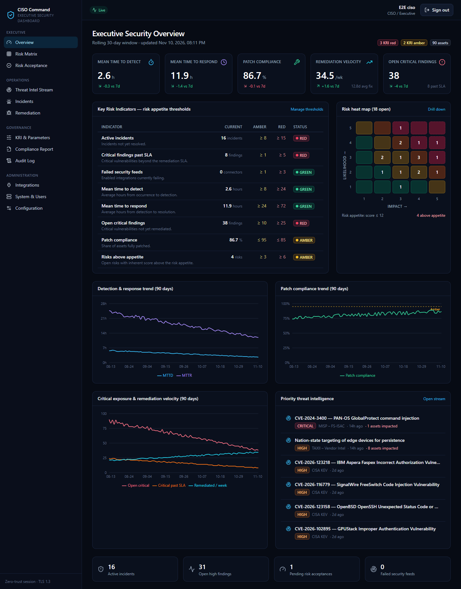

# CISO Executive Dashboard

A full-stack, zero-trust security posture dashboard for CISOs. It brings in data from SIEM, vulnerability, patch, change-management and threat-intel tools, and turns it into:

- **KPIs:** MTTD, MTTR, patch compliance, remediation velocity, open critical findings.
- **KRIs:** Red/Amber/Green status against your risk-appetite thresholds.
- **A 5×5 ISO 31000 risk matrix:** drill down from a cell to the risks, assets and vulnerabilities behind it.
- **A live threat-intelligence stream.**

| Layer | Stack |
|-------|-------|
| Frontend | React 18 · TypeScript · Vite · Tailwind CSS · lucide-react · Recharts |
| API | Node.js 22 · Express 5 · TypeScript · Zod · Prisma 6 |
| Data | PostgreSQL 17 (TLS 1.3, SCRAM, append-only audit; optional read replicas) |
| Identity | OpenID Connect (bundled Keycloak 26 with forced TOTP MFA; any OIDC IdP) |
| Edge | NGINX (unprivileged) — TLS 1.3 only, HSTS, strict CSP, mTLS to the API |
| Packaging | Multi-stage Dockerfiles · Docker Compose with segmented networks |

🚀 **Deployment guide (new system, migration, offline, load balancer):** [docs/DEPLOYMENT_GUIDE.md](docs/DEPLOYMENT_GUIDE.md)
📘 **User manual (every page, by role):** [docs/USER_MANUAL.md](docs/USER_MANUAL.md)
🛠 **Administration & maintenance manual (install, operate, back up, upgrade, troubleshoot):** [docs/MAINTENANCE_MANUAL.md](docs/MAINTENANCE_MANUAL.md)
🔌 **API & integration guide (REST API reference, connector requirements, OIDC):** [docs/API_AND_INTEGRATION_GUIDE.md](docs/API_AND_INTEGRATION_GUIDE.md)
📐 **Architecture diagrams:** [docs/ARCHITECTURE.md](docs/ARCHITECTURE.md)
🔀 **Flowcharts and sequence diagrams:** [docs/FLOWCHARTS.md](docs/FLOWCHARTS.md)
🖼 **Offline viewer:** open [docs/diagrams.html](docs/diagrams.html) in a browser. Raw sources are in [docs/diagrams/](docs/diagrams/).
🔐 **Security controls and the OWASP / NIST / PCI mapping:** [docs/SECURITY.md](docs/SECURITY.md)
⚙️ **Administrator-defined configuration (every parameter, how it applies):** [docs/CONFIGURATION.md](docs/CONFIGURATION.md)
🧪 **Test strategy and coverage:** [docs/TESTING.md](docs/TESTING.md)
🖥 **Screenshots:** [docs/screenshots/](docs/screenshots/)



---

## Quick start (Ubuntu 22.04+/24.04, RHEL 9, or Docker Desktop)

Prerequisites: Docker Engine 24+ with the Compose plugin (or Podman 4.9+ with `podman compose`), `openssl` and `bash`.

```bash
# 1. TLS material: internal CA + service certificate (use your PKI in production)
./scripts/generate-certs.sh ciso.corp.example        # or: localhost

# 2. Secrets: .env + ./secrets (random values, mode 600, git-ignored)
PUBLIC_BASE_URL=https://ciso.corp.example ./scripts/generate-secrets.sh

# 3. Build and start
docker compose up -d --build --wait

# 4. Verify (end-to-end checks: OIDC, RBAC, CSRF, SoD, SSRF, token rotation, audit chain, configuration)
./scripts/smoke-test.sh
```

Then open `https://<host>/`. Import `certs/ca.crt` into your browser or OS trust store, or accept the warning in development.

**Demo administrator:** sign in with **`admin` / `Admin@123!`**. At the first sign-in you must enrol an authenticator app: scan the QR code with Google Authenticator, Microsoft Authenticator, Authy or FreeOTP (TOTP, HmacSHA1, 6 digits, 30 s). The account exists only in the demo profile (`SEED_DEMO_DATA=true`). The password is published, so the deployment profile logs a warning when it is used on a non-local address. Override it before running `generate-secrets.sh` with `DEMO_ADMIN_USERNAME` and `DEMO_ADMIN_PASSWORD`.

**Other demo accounts:** `ciso.demo`, `admin.demo`, `secops.demo`, `patch.demo`, `auditor.demo`. They share one initial password, `DEMO_USER_PASSWORD` in `.env`. At first login each account must change its password and enrol an authenticator app.

**Upgrading an existing installation:** run `scripts/generate-secrets.sh --upgrade` to add newly required secrets (it never touches existing ones), then run `docker compose up -d --build --wait`.

**Stop:** `docker compose down`. **Wipe all data:** `docker compose down -v`.

On Windows (Git Bash), run the scripts with `bash scripts/<name>.sh` and set `APP_UID=1000` and `APP_GID=1000` in `.env`.

---

## Roles and access control

Roles come from the IdP's `roles` claim and are mapped by `OIDC_ROLE_MAPPING`. The API enforces every permission; the UI only hides what a role cannot use.

| Capability | CISO | Admin | SecOps | Patch Admin | Auditor |
|------------|:---:|:---:|:---:|:---:|:---:|
| Executive overview, KPIs, KRIs, risk matrix, threat stream | ✅ | ✅ | ✅ | ✅ | ✅ (read) |
| Edit KRI thresholds and risk parameters | ✅ | ✅ | | | |
| Register and edit risks | ✅ | | ✅ | | |
| Request a risk acceptance | ✅ | | ✅ | ✅ | |
| **Approve risk acceptance** (never your own request) | ✅ | | | | |
| Manage integrations (endpoints, credentials, test, sync) | view | ✅ | ✅ | | |
| Triage threats | ✅ | | ✅ | | |
| Log and update incidents | | | ✅ | | |
| Update remediation status, link change tickets | | | | ✅ | |
| Users, sessions, system health; enrol identities, roles, MFA reset | view users | ✅ | | | |
| Configuration page (network, rate limits, identity, deployment, host OS…) | view | ✅ edit | | | view |
| Audit log (view, verify, export) and compliance report | ✅ | ✅ | | | ✅ |

---

## Functional modules

- **Integration layer:** 19 parameterised connectors. Each one is configured in the UI with:
  - its endpoint, polling interval and auth mode (API key, Basic, OAuth2 client credentials, or mTLS)
  - vendor-specific settings and a custom CA
  - **advanced API parameters**: an API-gateway path prefix, version headers (for example QRadar `Version` or Elastic `elastic-api-version`), tenant query parameters, a timeout, and retries with back-off that honours `Retry-After`

  Each connector has *Test connection* and *Sync now* actions. Four **generic REST/JSON adapters** (SIEM, vulnerability, patch, change) connect any vendor without code. You set the field mapping and choose a pagination style: offset/limit, page number, body cursor, or RFC 8288 `Link` header.

  | Category | Connectors |
  |----------|------------|
  | SIEM | Splunk ES · Elastic Security · IBM QRadar |
  | Vulnerability | Tenable VM · Nessus · Qualys VMDR |
  | Patch | WSUS (via [tools/wsus-bridge.ps1](tools/wsus-bridge.ps1)) · Ansible AWX/AAP · Red Hat Satellite |
  | Change | ServiceNow · Jira |
  | Threat intel | MISP · STIX/TAXII 2.1 · CISA KEV (enabled by default) · generic commercial JSON |
  | Any category | Generic REST/JSON SIEM · vulnerability · patch · ITSM change adapters |

  Credentials are encrypted with AES-256-GCM and are write-only: the API never returns them. Outbound calls pass through an SSRF egress guard.

- **KPI & KRI engine:** live KPI calculation, a snapshot every 15 minutes for trend charts, and a KRI check every 5 minutes. Breaches go to a breach register that CISO, SecOps and Admin can acknowledge.

- **Risk:** the 5×5 likelihood × impact heat map is marked against your risk appetite. You can drill down from a cell to its risks, their linked assets, and those assets' open vulnerabilities with SLA due dates. Risk acceptance has an approval workflow with expiry.

- **Threat intelligence stream:** CVEs, ransomware advisories, supply-chain risks and IOCs. Filter by type, severity, source, status, text, or *impacting my assets*. Each item shows its source and how many of your assets it affects. Updates arrive live over SSE.

- **Incidents and remediation:** MTTD and MTTR are calculated from incident lifecycle timestamps. Vulnerabilities carry SLA due dates and can be linked to a change ticket.

- **Governance:** the audit log is immutable and hash-chained, with integrity verification and CSV export. A live compliance report maps controls to NIST 800-53 AU and PCI DSS v4.0.1 Requirements 8 and 10.

- **Dynamic configuration:** the administrator defines every platform parameter on the **Configuration** page. Each parameter is validated, audited with before/after values, and applied in one of four ways:
  - *live*: network allowlists, rate limits, egress policy, log level, demo generator
  - *identity-provider sync*: MFA/TOTP algorithm, password and lockout policy, session lifetimes
  - *redeploy*: public URL or IP, ports, certificate names, trusted load balancers, memory limits, applied with `scripts/apply-deployment.sh`
  - *host OS script*: NTP, DNS, syslog to SIEM, edge firewall, SSH restriction, updates, sysctl, auditd, Docker log rotation, for Ubuntu or RHEL

  See [docs/CONFIGURATION.md](docs/CONFIGURATION.md).

- **Identity & enrolment:** administrators enrol users with a one-time password and assign roles. They can reset passwords or authenticators, disable or delete users, and enforce MFA for existing users. The dashboard prevents changes to your own identity and keeps at least one administrator.

- **Dynamic demo data:** in the demo profile, a live simulator creates and progresses incidents, findings, remediations, threat intel and patch drift at administrator-defined hourly rates. *Regenerate demo dataset* rebuilds the data at the sizes you configure.

---

## Repository layout

```
backend/                 Express API (TypeScript, ESM)
  prisma/                schema + migrations (incl. audit triggers, least-privilege grants)
  src/auth/              OIDC RP, sessions, JWT, RBAC, middleware
  src/audit/             hash-chained audit service + routes
  src/connectors/        framework: egress guard, HTTP client (retries, API parameters), 19 adapters, ingest, runner
  src/modules/           kpi · risk · threats · incidents · remediation · integrations · admin · compliance · stream · settings · config · identity
  src/idp/               Keycloak admin client, policy sync, enrolment, idp-init bootstrap
  src/demo/              demo dataset generator + live simulator
  src/scheduler/         polling leases, snapshots, KRI evaluation, retention
  test/                  unit tests (crypto, RBAC, SSRF, audit chain, KPI maths)
frontend/                React SPA (pages, components, hooks)
infra/                   gateway Dockerfile + runtime config renderer, nginx, postgres (TLS entrypoint, hba, init), keycloak realm
scripts/                 generate-certs.sh · generate-secrets.sh · apply-deployment.sh · smoke-test.sh · run-all-tests.sh
tests/                   Playwright e2e suite (tests/e2e) + vendor API simulator (tests/vendor-sim)
tools/                   wsus-bridge.ps1
docs/                    architecture, flowcharts, security, testing, diagrams, screenshots
```

## Testing

```bash
scripts/run-all-tests.sh      # unit tests → builds → fresh stack with dummy data + vendor simulator
                              # → Playwright end-to-end suite → bash smoke test
```

The full pipeline covers:
- unit tests
- every page for every role, in a real browser
- a 63-endpoint × 5-role RBAC matrix
- MFA enrolment, demo-administrator sign-in, and enrolment of new users from the UI
- all 19 connectors against a vendor API simulator, including generic adapters with four pagination styles, API parameters and retries
- every configuration class changed and verified end to end:
  - rate limits (per user, HTTP 429)
  - network and admin-console allowlists at the gateway
  - IdP policy sync
  - egress allowlist
  - deployment profile and host scripts, dry-run on Ubuntu and Rocky
  - live demo simulator and dataset regeneration
  - gateway re-routing after the API container gets a new IP
- audit tamper detection, database privileges and TLS, container and network isolation
- key rotation and rate limiting

Details are in [docs/TESTING.md](docs/TESTING.md).

## Development

```bash
cd backend && npm ci && npx prisma generate
npm run typecheck && npm test            # unit tests
cd ../frontend && npm ci && npm run build
```

To develop the API outside Docker, run `docker compose up -d postgres keycloak`. Then export the variables listed in [backend/src/config/env.ts](backend/src/config/env.ts) (the `*_FILE` variables can point at `./secrets/*`) and run `npm run dev`. `vite dev` proxies `/api` to `https://localhost`.

### Database migrations

```bash
cd backend
npx prisma migrate dev --name <change>       # against a dev database
docker compose up -d --force-recreate migrate api   # applies pending migrations, then restarts the API
```

The `migrate` service connects as the schema owner. The API runs as `ciso_app`, which has DML rights only and cannot UPDATE or DELETE `audit_log`.

## Configuration reference (API)

| Variable | Default | Purpose |
|----------|---------|---------|
| `PUBLIC_BASE_URL` | — | External https URL (cookies, OIDC redirect, CSRF origin) |
| `DATABASE_URL[_FILE]` / `DATABASE_REPLICA_URLS` | — | Primary database and optional comma-separated read replicas |
| `OIDC_ISSUER_URL`, `OIDC_DISCOVERY_URL`, `OIDC_CLIENT_ID`, `OIDC_CLIENT_SECRET[_FILE]` | — | IdP settings |
| `OIDC_ROLE_CLAIM`, `OIDC_ROLE_MAPPING` | `roles`, `administrator:ADMIN,…` | Map IdP roles or groups to app roles |
| `ACCESS_TOKEN_TTL_SEC` / `REFRESH_IDLE_TTL_SEC` / `SESSION_ABSOLUTE_TTL_SEC` | 600 / 900 / 28800 | Initial session lifetimes (then administrator-defined) |
| `IDP_ADMIN_URL`, `IDP_REALM`, `IDP_PROVISIONER_CLIENT_ID`, `IDP_PROVISIONER_CLIENT_SECRET[_FILE]` | Keycloak / `ciso` / `ciso-provisioner` | Identity-provider administration (unset for external IdPs) |
| `DEMO_MODE` | `SEED_DEMO_DATA` | Enables the demo simulator and dataset regeneration |
| `DATA_ENCRYPTION_KEYS[_FILE]`, `DATA_ENCRYPTION_ACTIVE_KEY` | — / `v1` | AES-256 key ring (`id:base64,…`) |
| `JWT_SECRET`, `STATE_ENCRYPTION_KEY`, `BLIND_INDEX_KEY`, `AUDIT_HMAC_KEY` (`_FILE`) | — | Signing, state, blind-index and audit-chain keys |
| `SECRETS_PROVIDER` | `env` | `vault` loads secrets from HashiCorp Vault KV v2 |
| `CONNECTOR_ALLOWED_HOSTS` / `CONNECTOR_DENIED_HOSTS` / `CONNECTOR_BLOCKED_CIDRS` | — | Egress policy |
| `CONNECTOR_BLOCK_PRIVATE_NETWORKS` / `CONNECTOR_ALLOW_INSECURE_HTTP` | false / false | Egress policy toggles (insecure HTTP is refused in production) |
| `TLS_CERT_FILE`, `TLS_KEY_FILE`, `TLS_CA_FILE`, `TLS_REQUIRE_CLIENT_CERT` | — | API HTTPS listener and mTLS |

Environment variables bootstrap the platform. Everything an administrator should own at runtime is on the **Configuration** page, and every change is audited:
- risk appetite, SLAs, acceptance validity, KPI window and retention
- network access and rate limits
- session lifetimes, MFA and password policy
- integration egress defaults and log level
- the demo generator
- the deployment profile and the host OS baseline

The full reference is in [docs/CONFIGURATION.md](docs/CONFIGURATION.md).

## Using a corporate IdP instead of Keycloak

1. Register a confidential web app with redirect URI `https://<host>/api/auth/callback` and post-logout URI `https://<host>/`.
2. Emit a roles or groups claim. For example, in Entra ID use app roles in the `roles` claim. Set `OIDC_ROLE_CLAIM` and `OIDC_ROLE_MAPPING`, e.g. `CISO-Dashboard-Execs:CISO,SOC-Analysts:SECOPS`.
3. Set `OIDC_ISSUER_URL` (and leave `OIDC_DISCOVERY_URL` unset) and put the client secret in `secrets/oidc_client_secret`.
4. Remove the `keycloak` service and the `/auth/` locations from `infra/nginx/nginx.conf`.

## Operations

- **Backups:** dump **both** databases. `ciso` holds the dashboard data; `keycloak` holds identities and MFA enrolments. Then encrypt the dumps, and back up `secrets/`, `certs/` and `.env` to your vault separately. Restore steps are in [docs/MAINTENANCE_MANUAL.md §8](docs/MAINTENANCE_MANUAL.md#8-backup-and-restore).
  ```bash
  for db in ciso keycloak; do
    docker compose exec -T postgres sh -c "PGPASSWORD=\"\$POSTGRES_PASSWORD\" pg_dump -U \"\$POSTGRES_USER\" -Fc $db" > "$db-$(date +%F).dump"
  done
  ```
- **Key rotation:** see [docs/SECURITY.md §4](docs/SECURITY.md#key-rotation-no-downtime).
- **Logs:** all containers write JSON logs to stdout. Ship them to your SIEM with the Docker logging driver or a log agent.
- **Hosting on a server (not localhost):** in *Configuration → Deployment*, set the public URL, for example `https://10.20.5.15` or `https://ciso.corp.example`. You can also set alternative names or IPs and trusted load balancers. Download `deployment.env` and run `scripts/apply-deployment.sh deployment.env` on the Docker host. The script validates the profile, backs up `.env`, re-issues the TLS certificate under your CA when names change, and redeploys. Keycloak redirect URIs follow automatically.
- **Keycloak admin console:** always reachable from the Docker host (`ssh -L 8443:localhost:443 vm`, then `https://localhost:8443/auth/admin/`). It is also reachable from any networks you add in *Configuration → Network access*.
- **Host OS:** *Configuration → Host operating system* generates an idempotent baseline script for Ubuntu or RHEL. Review it, run it with `--dry-run`, then run it with `sudo`. The dashboard never changes the host itself.
- **RHEL / SELinux:** bind mounts use `:z` relabelling. With Podman, run `podman compose up -d --build`.
