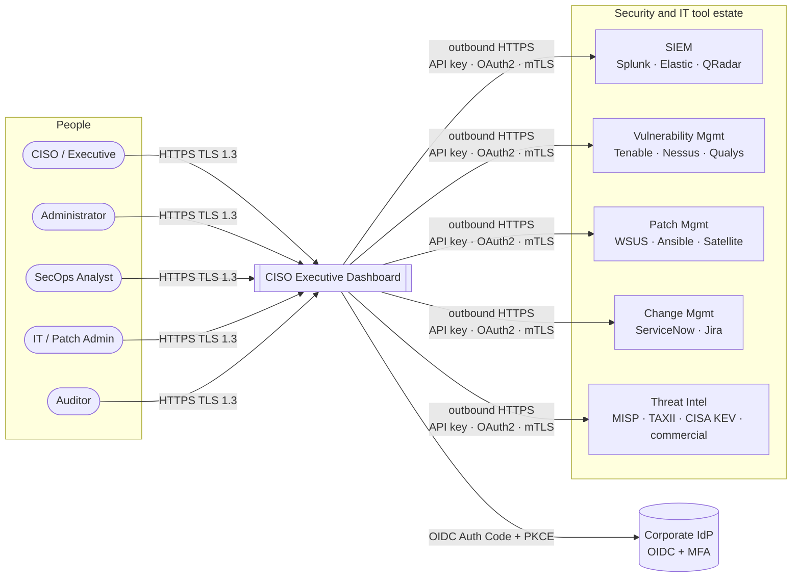
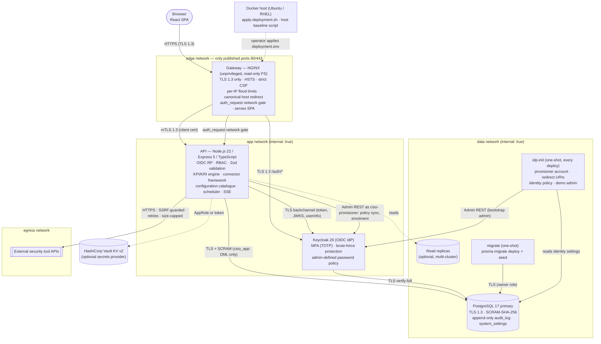

# Architecture — CISO Executive Dashboard

All diagrams are [Mermaid](https://mermaid.js.org) and render natively on GitHub/GitLab,
in VS Code (Markdown Preview Mermaid Support), or by opening [`diagrams.html`](diagrams.html)
in a browser. Source files for each diagram also live in [`diagrams/`](diagrams/) for reuse
in other tools (e.g. `mmdc -i diagrams/01-system-context.mmd -o out.svg`).

---

## 1. System context

## 2. Container / deployment view (zero-trust network zones)

| Zone | Members | Exposure |
|------|---------|----------|
| `edge` | gateway | Ports 80 (redirect + health) and 443 published on the host |
| `app` | gateway, api, keycloak | Internal only — no route to the internet |
| `data` | api, migrate, keycloak, postgres | Internal only |
| `egress` | api | Outbound to security tool APIs; `172.30.0.0/16` blocked by the connector SSRF guard |

## 3. API component view

```mermaid
flowchart TB
    subgraph Pipeline["Request pipeline (app.ts)"]
        direction LR
        H[helmet headers<br/>no-store] --> RL[per-IP rate limit<br/>admin-defined] --> NET[network allowlist<br/>admin-defined] --> CSRF[CSRF guard<br/>Origin + double-submit] --> AUTHN[authenticate<br/>JWT + live session] --> URL[per-user rate limit] --> RBAC[requirePermission] --> ZOD[Zod .strict schemas]
    end

    subgraph Modules
        AUTH[auth<br/>OIDC · sessions · tokens]
        KPI[kpi / kri<br/>engine · trends · breaches]
        RISK[risk<br/>5×5 matrix · drill-down · acceptance]
        THR[threats<br/>stream · facets · triage]
        INC[incidents]
        REM[remediation<br/>vulns · assets · change tickets]
        INT[integrations<br/>connector config · test · sync]
        ADMIN[admin<br/>users · settings · system]
        CONF[config<br/>status · drift · bundles · demo tools]
        IDN[identity<br/>enrolment · roles · MFA reset · policy sync]
        AUDIT[audit<br/>query · verify · CSV export]
        COMP[compliance report]
        SSE["stream — SSE"]
    end

    subgraph Core
        CRYPTO[crypto<br/>AES-256-GCM key ring<br/>HMAC blind index]
        AUDSVC[audit service<br/>HMAC hash chain]
        PRISMA[Prisma client<br/>+ read replicas]
        EVENTS[event hub]
        SCHED[scheduler<br/>connector leases · snapshots<br/>KRI eval · retention<br/>live settings · IdP policy · demo ticks]
        CAT[configuration catalogue<br/>schemas · apply modes · warnings]
        KCA[Keycloak admin client<br/>provisioner service account]
        SIM[demo simulator<br/>dataset generator]
    end

    subgraph Connectors["Connector framework"]
        REG[registry<br/>19 adapters incl. generic REST/JSON]
        HTTP[ConnectorHttpClient<br/>API key · Basic · OAuth2 · mTLS<br/>API parameters · retries]
        EGR[egress policy<br/>connect-time IP checks]
        ING[ingest<br/>normalised upserts only]
    end

    Pipeline --> Modules
    Modules --> AUDSVC & PRISMA & EVENTS
    INT --> REG
    SCHED --> REG
    REG --> HTTP --> EGR
    REG --> ING --> PRISMA
    AUTH & INT & INC & RISK --> CRYPTO
    SSE --> EVENTS
    ADMIN & CONF & IDN --> CAT
    IDN --> KCA
    CONF --> SIM
    SCHED --> SIM & KCA
```

## 4. Data model

```mermaid
erDiagram
    USER ||--o{ SESSION : has
    ASSET ||--o{ VULNERABILITY : exposes
    CHANGE_TICKET ||--o{ VULNERABILITY : remediates
    RISK ||--o{ RISK_ASSET : links
    ASSET ||--o{ RISK_ASSET : links
    RISK ||--o{ RISK_ACCEPTANCE : "accepted via"
    KRI_DEFINITION ||--o{ KRI_BREACH : "breached by (kriKey)"

    USER {
        uuid id PK
        string subject UK "OIDC sub"
        string emailEnc "AES-256-GCM"
        string emailIndex UK "HMAC blind index"
        enum_list roles "OIDC-mapped"
        bool active
    }
    SESSION {
        uuid id PK
        uuid familyId "rotation family"
        string refreshHash UK "SHA-256 only"
        string idpRefreshEnc "AES-256-GCM"
        datetime expiresAt "idle"
        datetime absoluteExpiresAt
        datetime revokedAt
    }
    CONNECTOR {
        uuid id PK
        string vendor
        enum category
        string baseUrl
        enum authMode
        int pollIntervalSec
        json settings
        json requestOptions "path prefix, headers, query, timeout, retries"
        string secretEnc "AES-256-GCM, AAD=connector id"
        enum status
    }
    ASSET {
        uuid id PK
        string hostname UK
        int criticality "1-5"
        bool patchCompliant
    }
    VULNERABILITY {
        uuid id PK
        string source
        string externalId
        string cveId
        enum severity
        enum status
        datetime dueAt "SLA"
        datetime remediatedAt
    }
    INCIDENT {
        uuid id PK
        enum severity
        enum status
        datetime occurredAt
        datetime detectedAt "MTTD"
        datetime resolvedAt "MTTR"
        string descriptionEnc
    }
    THREAT_ITEM {
        uuid id PK
        enum type "CVE|RANSOMWARE|SUPPLY_CHAIN|ADVISORY|IOC"
        enum severity
        string source "attribution"
        int impactedAssetCount
    }
    RISK {
        uuid id PK
        int likelihood "1-5"
        int impact "1-5"
        enum status
    }
    RISK_ACCEPTANCE {
        uuid id PK
        string justificationEnc
        uuid requestedById
        uuid decidedById "≠ requester (SoD)"
        enum status
        datetime expiresAt
    }
    KRI_DEFINITION {
        string key UK
        string metric
        enum direction
        float amberThreshold
        float redThreshold
    }
    AUDIT_LOG {
        bigint id PK
        timestamptz ts
        string action
        string outcome
        json details
        string prevHash
        string hash UK "HMAC-SHA256 chain"
    }
```

## 5. Technology choices

| Concern | Choice | Why |
|---------|--------|-----|
| Frontend | React 18, TypeScript, Vite, Tailwind CSS, lucide-react, Recharts | Typed, fast builds, no inline scripts/styles → strict CSP |
| Backend | Node.js 22, Express 5, TypeScript (ESM) | Single language across the stack; Express 5 propagates async errors |
| Validation | Zod `.strict()` schemas on every body/query/param | Rejects unknown keys (mass assignment), enforces types/lengths |
| ORM | Prisma 6 (parameterised queries), `@prisma/extension-read-replicas` | SQL-injection-safe by construction; read scaling across clusters |
| Database | PostgreSQL 17 | Triggers for append-only audit, CHECK constraints, SCRAM, TLS 1.3 |
| Identity | OpenID Connect (Keycloak bundled; any compliant IdP) | MFA, brute-force protection and lifecycle mastered in the IdP |
| Sessions | 10-min HS512 JWT + rotating opaque refresh token in `__Host-` cookies | Short-lived, httpOnly, SameSite=Strict, server-side revocation |
| Crypto | AES-256-GCM (AAD-bound), HMAC-SHA256 | Authenticated encryption; tamper-evident audit chain |
| Edge | NGINX unprivileged, TLS 1.3 only | HSTS, CSP, rate limiting, mTLS to the API |
| Packaging | Multi-stage Dockerfiles, Compose with segmented networks | Non-root, read-only root FS, `cap_drop: ALL`, `no-new-privileges` |

## 6. Scaling and multi-cluster notes

* **Database:** set `DATABASE_REPLICA_URLS` to route reads to replicas (streaming replication / Patroni / cloud read replicas). Writes, transactions and the audit chain always use the primary.
* **API replicas:** connector polling uses a DB lease (`connectors.leaseUntil`) so several API instances never run the same connector concurrently. The SSE hub is in-process; for >1 replica, replace `lib/events.ts` with PostgreSQL `LISTEN/NOTIFY` or Redis pub/sub.
* **Gateway:** stateless; place several behind an L4 load balancer.
