# Process Flows & Flowcharts — CISO Executive Dashboard

Mermaid sources; render on GitHub/GitLab, in VS Code, or via [`diagrams.html`](diagrams.html).

1. [OIDC sign-in (Authorization Code + PKCE)](#1-oidc-sign-in-authorization-code--pkce)
2. [Zero-trust request pipeline](#2-zero-trust-request-pipeline)
3. [Session refresh, rotation & theft detection](#3-session-refresh-rotation--theft-detection)
4. [Connector sync with zero data retention](#4-connector-sync-with-zero-data-retention)
5. [KPI snapshot & KRI breach evaluation](#5-kpi-snapshot--kri-breach-evaluation)
6. [Risk acceptance lifecycle](#6-risk-acceptance-lifecycle)
7. [Tamper-evident audit write & verification](#7-tamper-evident-audit-write--verification)
8. [Risk matrix drill-down (user journey)](#8-risk-matrix-drill-down-user-journey)
9. [Deployment & bootstrap](#9-deployment--bootstrap)

---

## 1. OIDC sign-in (Authorization Code + PKCE)

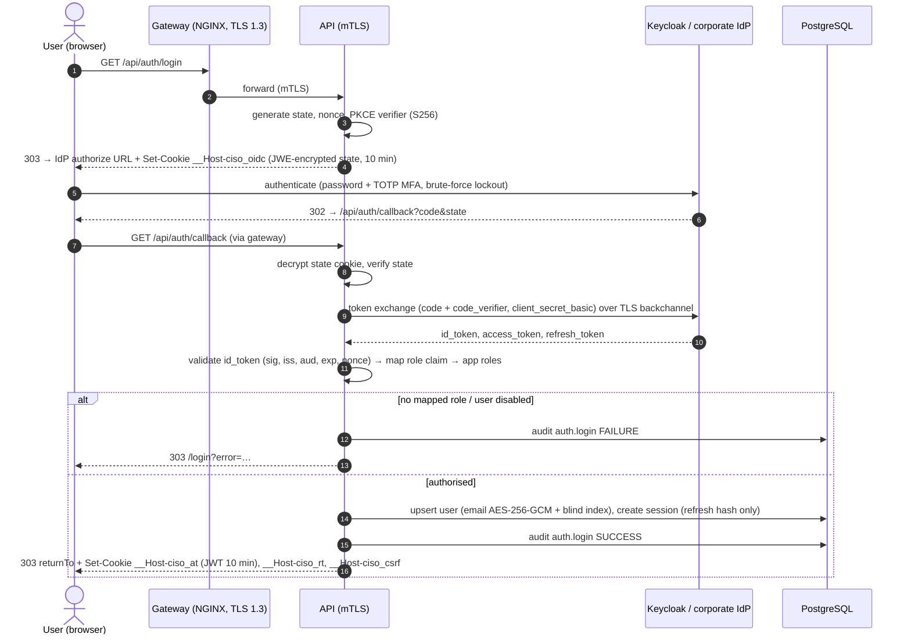

## 2. Zero-trust request pipeline

Every API call is re-verified; nothing is trusted because of network location.

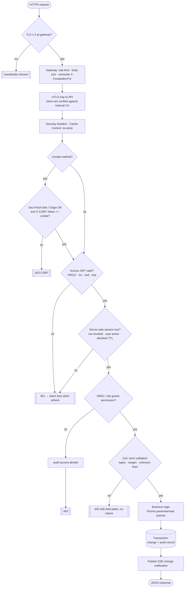

## 3. Session refresh, rotation & theft detection

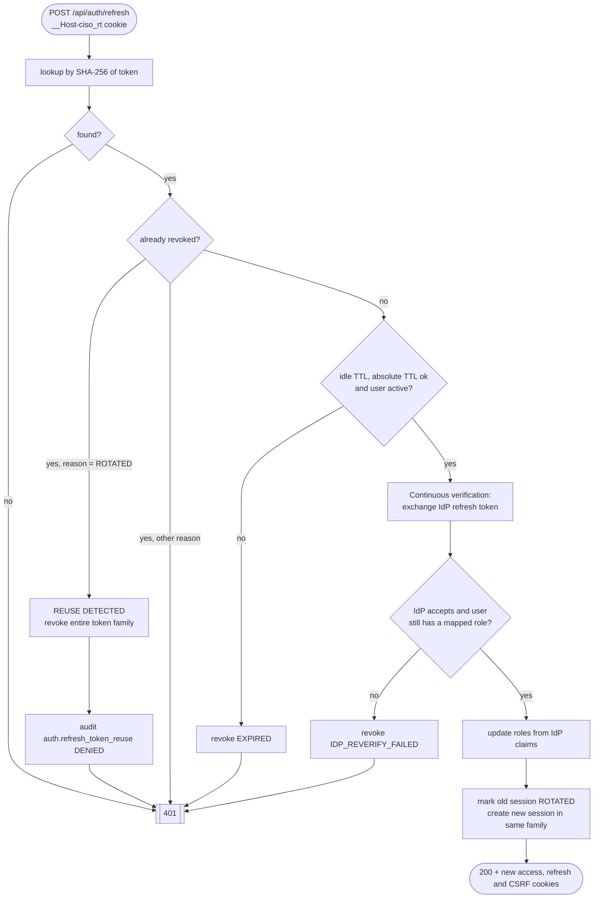

## 4. Connector sync with zero data retention

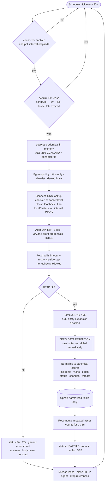

## 5. KPI snapshot & KRI breach evaluation

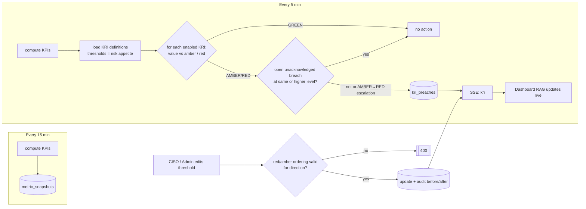

KPI definitions (rolling window, default 30 days, configurable):

| KPI | Formula |
|-----|---------|
| MTTD | mean(`detectedAt − occurredAt`) for incidents detected in window |
| MTTR | mean(`resolvedAt − detectedAt`) for incidents resolved in window |
| Patch compliance % | assets with `patchCompliant` ÷ all assets × 100 |
| Remediation velocity | findings remediated in window ÷ (window ÷ 7) per week |
| Open critical findings | CRITICAL vulns in OPEN / IN_PROGRESS |

## 6. Risk acceptance lifecycle

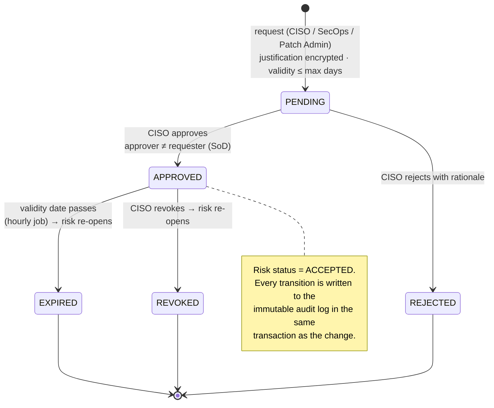

## 7. Tamper-evident audit write & verification

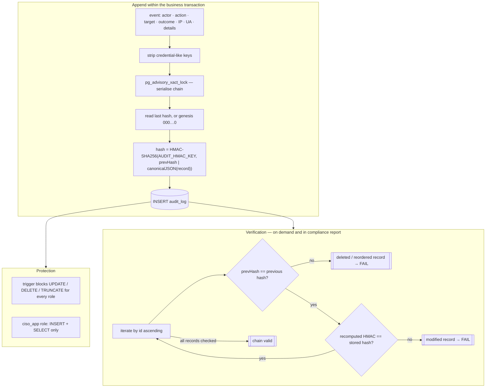

## 8. Risk matrix drill-down (user journey)

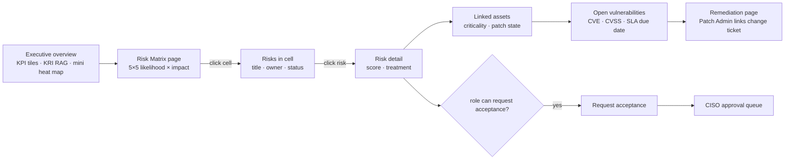

## 9. Deployment & bootstrap

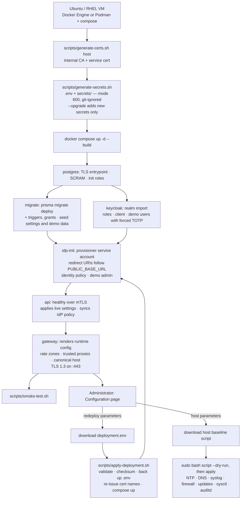

## 10. Administrator-defined configuration (save → validate → audit → apply)

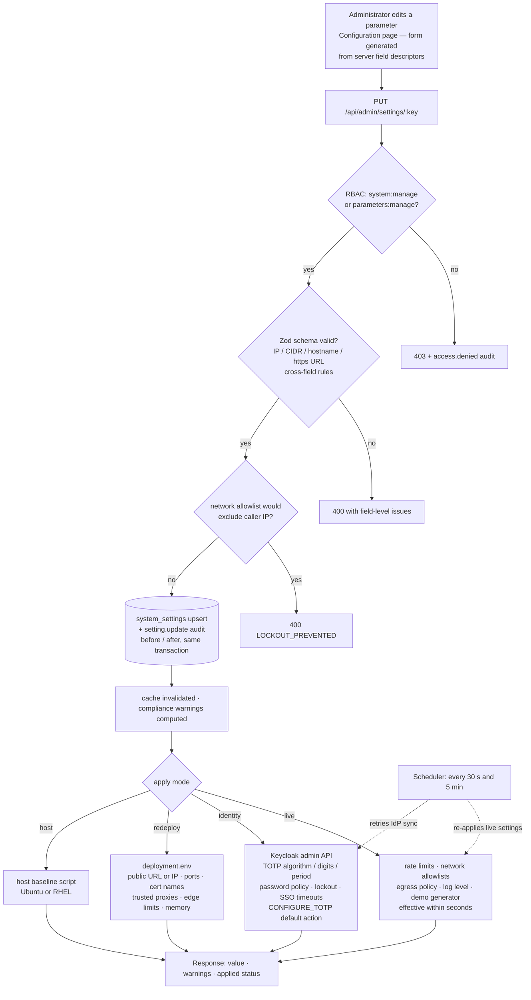

## 11. Identity enrolment with enforced authenticator-app MFA

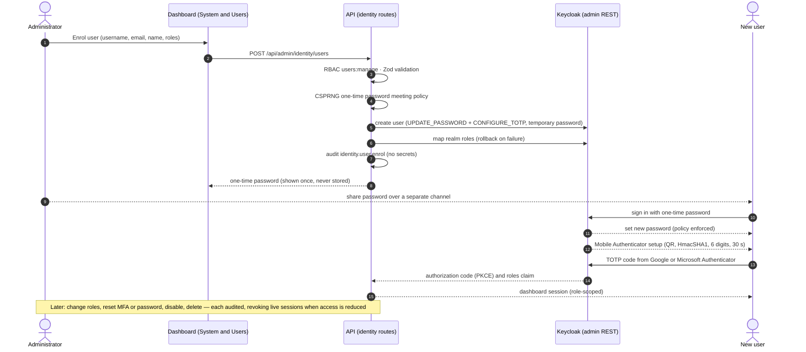
