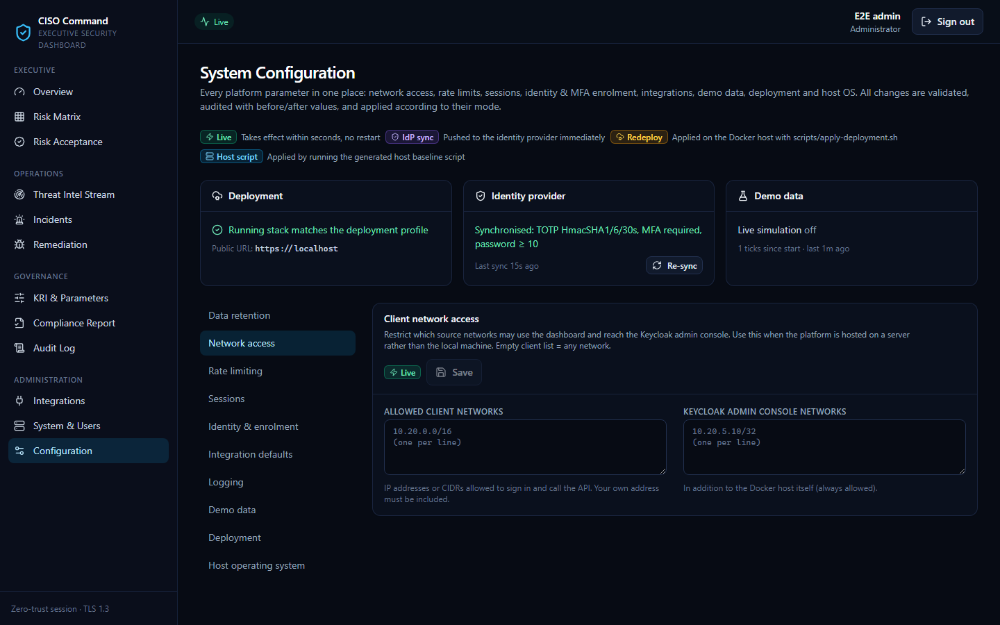

# CISO Executive Dashboard: Administration & Maintenance Manual

**Audience:** platform administrators, system and operations engineers, and security engineers who install, configure, operate and support the dashboard.
**Assumes:** working knowledge of Linux, Docker Compose, TLS/PKI and OpenID Connect.

**Related documents:**
- [User Manual](USER_MANUAL.md)
- [API & Integration Guide](API_AND_INTEGRATION_GUIDE.md)
- [Configuration reference](CONFIGURATION.md)
- [Security architecture](SECURITY.md)
- [Architecture](ARCHITECTURE.md)
- [Testing](TESTING.md)

---

## Contents

1. [System overview](#1-system-overview)
2. [Requirements](#2-requirements)
3. [Installation](#3-installation)
4. [First-day configuration checklist](#4-first-day-configuration-checklist)
5. [Identity and user administration](#5-identity-and-user-administration)
6. [Configuration management](#6-configuration-management)
7. [Routine operations](#7-routine-operations)
8. [Backup and restore](#8-backup-and-restore)
9. [Monitoring, health and logs](#9-monitoring-health-and-logs)
10. [Upgrades and database migrations](#10-upgrades-and-database-migrations)
11. [Secrets, keys and certificates](#11-secrets-keys-and-certificates)
12. [Scaling and availability](#12-scaling-and-availability)
13. [Troubleshooting runbook](#13-troubleshooting-runbook)
14. [Verification and testing](#14-verification-and-testing)
15. [Decommissioning](#15-decommissioning)
16. [Reference](#16-reference)

---

## 1. System overview

### 1.1 Components

| Service | Image | Role | Networks |
|---------|-------|------|----------|
| `gateway` | `ciso-dashboard/gateway` (NGINX, unprivileged) | The only published service. It terminates TLS 1.3, serves the SPA, proxies `/api/` to the API over mTLS and `/auth/` to Keycloak, enforces edge rate limits, and applies the network gate for identity pages | edge, app |
| `api` | `ciso-dashboard/api` (Node.js 22) | REST API, SSE stream, scheduler (connector polling, KPI snapshots, KRI evaluation, housekeeping, demo simulator) | app, data, egress |
| `postgres` | `postgres:17-alpine` | Two databases: `ciso` (dashboard) and `keycloak` (identities, MFA). TLS, SCRAM-SHA-256, data checksums | data |
| `keycloak` | `quay.io/keycloak/keycloak:26.4` | OpenID Connect identity provider with forced TOTP MFA (realm `ciso`) | app, data |
| `migrate` | API image, one-shot | Applies Prisma migrations as the schema owner, then exits | data |
| `idp-init` | API image, one-shot | Bootstraps Keycloak: the provisioner service account, the dashboard client redirect URIs, the identity policy and (demo only) the demo administrator | data |

### 1.2 Network zones

| Network | Subnet | Internet | Members |
|---------|--------|----------|---------|
| `edge` | 172.30.0.0/24 | inbound only, via published ports | gateway |
| `app` | 172.30.1.0/24 | none (internal) | gateway, api, keycloak |
| `data` | 172.30.2.0/24 | none (internal) | postgres, api, keycloak, migrate, idp-init |
| `egress` | 172.30.3.0/24 | outbound | api only, for connector calls |

Only the gateway publishes ports: `HTTPS_PORT` (default 443) maps to 8443 in the container, and `HTTP_PORT` (default 80, redirect only) maps to 8080. The database and Keycloak are never reachable from outside Docker.

### 1.3 Background jobs (inside the API)

| Job | Interval | Purpose |
|-----|----------|---------|
| `connectors` | 30 s | Polls each enabled connector when its interval is due. A database lease stops two replicas syncing the same connector |
| `kpi-snapshot` | 15 min | Stores KPI values for trend charts |
| `kri-evaluation` | 5 min | Computes RAG status and records breaches |
| `housekeeping` | 60 min | Expires risk acceptances, purges threat items and snapshots past retention, deletes sessions more than 30 days past expiry |
| `live-settings` | 30 s | Re-applies live settings, so replicas converge |
| `idp-policy` | 5 min | Re-pushes the identity policy to Keycloak if the last sync failed or is older than 1 hour |
| `demo-simulator` | 15 s check | Demo mode only: runs a simulation tick when the configured interval has elapsed |

### 1.4 Where data lives

| Data | Location | Protection |
|------|----------|------------|
| Dashboard records (risks, incidents, findings, settings, audit) | PostgreSQL `ciso`, volume `pgdata` | TLS in transit; sensitive fields encrypted with AES-256-GCM; audit log append-only and hash-chained |
| Identities, password hashes, TOTP secrets | PostgreSQL `keycloak`, volume `pgdata` | Managed by Keycloak |
| Connector credentials | `connectors.secretEnc` (database) | AES-256-GCM, bound to the connector ID; never returned by the API |
| Platform secrets | `./secrets/*` (mode 600), `.env` | Git-ignored; optionally loaded from HashiCorp Vault |
| TLS material | `./certs/` | `ca.key` should be moved offline in production |

---

## 2. Requirements

### 2.1 Host

| Item | Minimum | Recommended (production) |
|------|---------|--------------------------|
| CPU | 2 vCPU | 4 vCPU |
| Memory | 6 GB | 8 GB or more. Default container limits: API 1 GB, Keycloak 1.5 GB, PostgreSQL 2 GB, gateway 256 MB |
| Disk | 20 GB SSD | 40 GB+ SSD, encrypted with LUKS2 (see [SECURITY.md §4](SECURITY.md#full-database-encryption-at-rest)) |
| OS | Ubuntu 22.04 / 24.04 LTS, RHEL / Rocky / Alma 9 | Same, with the generated host baseline applied |
| Runtime | Docker Engine 24+ with the Compose v2 plugin, or Podman 4.9+ with `podman compose` | Docker Engine (current stable) |
| Tools | `bash`, `openssl`, `jq` (needed by the host baseline when `daemon.json` exists) | — |
| Time | NTP-synchronised | chrony via the host baseline. TOTP codes and audit timestamps depend on accurate time |

Windows with Docker Desktop is supported for development and demonstration. Run the scripts from Git Bash and set `APP_UID=1000` and `APP_GID=1000` in `.env`.

### 2.2 Network

| Direction | Port / protocol | Purpose |
|-----------|-----------------|---------|
| Inbound | TCP 443 (or your `HTTPS_PORT`) | Users and load balancers |
| Inbound | TCP 80 (or your `HTTP_PORT`) | Redirect to HTTPS only (optional) |
| Inbound | TCP 22 | SSH administration; restrict it with the host baseline |
| Outbound | TCP 443 to each security tool's API | Connectors (https only) |
| Outbound | UDP 123 | NTP |
| Outbound | TCP 6514 (or your syslog port) | Optional host syslog to the SIEM over TLS |
| Outbound | TCP 443 to registries | Image builds and updates (`docker.io`, `quay.io`, `registry.npmjs.org`) |

### 2.3 DNS and certificates

- A DNS name (for example `ciso.corp.example`) or a fixed IP address for the public URL.
- For production, a server certificate from your enterprise PKI that covers the public name and any alternative names or IPs. Its file names must match those in `./certs` (see §11.4).

---

## 3. Installation

### 3.1 Production installation

```bash
# 1. Obtain the release and change into it
sudo mkdir -p /opt/ciso-dashboard && sudo chown "$USER" /opt/ciso-dashboard
cd /opt/ciso-dashboard          # copy or clone the release here

# 2. TLS: internal CA + service certificate (or copy your PKI files into ./certs)
CERT_SANS=10.20.5.15 ./scripts/generate-certs.sh ciso.corp.example

# 3. Secrets and .env (random values, mode 600). Production: no demo data, no demo admin.
PUBLIC_BASE_URL=https://ciso.corp.example SEED_DEMO_DATA=false ./scripts/generate-secrets.sh

# 4. Build and start; --wait blocks until every health check passes
docker compose up -d --build --wait

# 5. Verify end to end (63 checks: OIDC, RBAC, CSRF, SSRF, rotation, audit chain, configuration…)
./scripts/smoke-test.sh
```

### 3.2 Demonstration installation

```bash
./scripts/generate-certs.sh localhost
PUBLIC_BASE_URL=https://localhost ./scripts/generate-secrets.sh     # SEED_DEMO_DATA defaults to true
docker compose up -d --build --wait
```

The demo profile creates:
- **Sample data** at the sizes in *Configuration → Demo data*, and a **live simulator** that keeps the data moving.
- The **demo administrator `admin` / `Admin@123!`**, who must enrol TOTP at first sign-in.
- Demo role accounts: `ciso.demo`, `admin.demo`, `secops.demo`, `patch.demo` and `auditor.demo`. They share the password in `DEMO_USER_PASSWORD` in `.env`, and each must change it and enrol TOTP.

> ⚠️ `Admin@123!` is a published credential, and the demo profile lowers the minimum password length to 10 so that it is valid. Never expose a demo installation on an untrusted network. To harden one, delete the `admin` identity and set the minimum password length back to 12 or more.

### 3.3 What happens at start-up

1. `postgres` starts. On a new volume, `infra/postgres/init/01-roles.sh` creates the least-privilege `ciso_app` role and the `keycloak` role and database.
2. `keycloak` imports `infra/keycloak/realm-ciso.json` on first start only.
3. `migrate` applies pending migrations, including the audit triggers and grants.
4. `idp-init`:
   - creates or rotates the `ciso-provisioner` service account
   - points the `ciso-dashboard` client at `PUBLIC_BASE_URL`
   - pushes the identity policy
   - in demo mode, creates the demo admin

   It is the only container that ever receives the Keycloak bootstrap admin password.
5. `api` starts after these have completed successfully. It applies the live settings, syncs the identity policy and starts the scheduler.
6. `gateway` renders its runtime configuration (rate limits, trusted proxies, canonical-host redirect) and starts.

---

## 4. First-day configuration checklist

Do these in order after a production installation. All except step 1 are done in the browser as an administrator.

| # | Task | Where |
|---|------|-------|
| 1 | Create the first real administrator. Easiest: sign in to the Keycloak admin console from the Docker host (§5.5) and create the user with the `administrator` realm role. Alternatively, start in demo mode, enrol real administrators, then remove the demo admin | Keycloak console or System & Users |
| 2 | Confirm the identity policy: MFA required, **TOTP algorithm HmacSHA1**, password minimum ≥ 12, lockout settings | Configuration → Identity & enrolment |
| 3 | Set session lifetimes (idle ≤ 15 minutes for PCI DSS) | Configuration → Sessions |
| 4 | Restrict **client networks** and **Keycloak admin console networks** | Configuration → Network access |
| 5 | Set the deployment profile (public URL, alternative names, load balancers), then download and apply `deployment.env` | Configuration → Deployment (§6.3) |
| 6 | Set integration egress defaults: allowed hosts, private-network blocking, timeouts | Configuration → Integration defaults |
| 7 | Add connectors for each security tool, then **Test** and **Sync now** | Integrations ([API & Integration Guide, Part B](API_AND_INTEGRATION_GUIDE.md#part-b-integration-requirements-and-guidelines)) |
| 8 | Agree KRI thresholds, risk appetite and SLAs with the CISO | KRI & Parameters |
| 9 | Enrol users and assign roles | System & Users → Identity & enrolment |
| 10 | Generate, review and run the host OS baseline | Configuration → Host operating system (§6.4) |
| 11 | Schedule backups (§8) and log shipping (§9.4) | Host |
| 12 | Run `./scripts/smoke-test.sh` and record the result as commissioning evidence | Host |

---

## 5. Identity and user administration

There are two layers of account:
- **Identities** live in the identity provider (Keycloak, or your corporate IdP). They hold the password, MFA and **roles**.
- **Dashboard accounts** are created automatically at a user's first successful sign-in. They hold the last-login time, can be deactivated, and own the sessions.

### 5.1 Role mapping

| Keycloak realm role (default) | Dashboard role |
|-------------------------------|----------------|
| `administrator` | ADMIN |
| `ciso` | CISO |
| `secops_analyst` | SECOPS |
| `patch_admin` | PATCH_ADMIN |
| `auditor` | AUDITOR |

The mapping is set by `OIDC_ROLE_CLAIM` (default `roles`) and `OIDC_ROLE_MAPPING`. A user with no mapped role is refused at sign-in (`no_authorized_role`), and the refusal is audited.

### 5.2 Enrolling a user (System & Users → Identity & enrolment)

1. Select **Enrol user** and enter the username (3–64 characters: `a-z 0-9 . _ -`), email, first name, last name and roles.
2. The server creates the identity with a **CSPRNG one-time password** of at least 16 characters, covering all character classes, with the required actions *Update password* and *Configure OTP* (when MFA is required).
3. The one-time password is shown **once** and is never stored or logged. Give it to the user over a different channel from the username.

### 5.3 Changing access

| Action | Effect | Safeguards |
|--------|--------|------------|
| **Change roles** | Updates realm roles. If any role is removed, the user's IdP and dashboard sessions are ended | You cannot change yourself; at least one enabled ADMIN must remain |
| **Disable / Enable** | Disabling blocks sign-in and ends all sessions immediately | Same |
| **Reset password** | Issues a new one-time password (shown once) and ends sessions | You cannot reset yourself |
| **Reset MFA** | Deletes the user's authenticators and forces re-enrolment at next sign-in | You cannot reset yourself |
| **Delete** | Removes the identity and deactivates the dashboard account | Last-admin protection |
| **Dashboard account → Deactivate / Revoke sessions** | Blocks the account locally, or ends sessions without touching the identity | You cannot deactivate yourself |
| **Enforce MFA for existing users** (Configuration → Identity) | Adds *Configure OTP* to every identity that has no authenticator | — |

Every action is audited (`identity.user.*`, `user.*`) without secrets.

### 5.4 Leavers and movers

- **Leaver:** *Disable* immediately (sessions end within seconds). Delete after your retention period. The audit trail stays intact, because audit records store the actor's name and ID, not a reference that would break.
- **Mover:** change the roles. Removing a role ends the user's current sessions, so the new permissions apply at their next sign-in.

### 5.5 Keycloak admin console

- **URL:** `https://<public-host>/auth/admin/`, user `kcadmin`. The password is in `secrets/kc_bootstrap_admin_password`.
- It is always reachable from the **Docker host itself**, for example through an SSH tunnel: `ssh -L 8443:localhost:443 <host>`, then open `https://localhost:8443/auth/admin/`. Other networks are allowed only if they are listed in *Configuration → Network access → Keycloak admin console networks*.
- Use the console for break-glass tasks and for anything the dashboard does not cover, such as unlocking a permanently locked user (*Users → user → Unlock*) or reviewing sign-in events.

### 5.6 Using a corporate IdP (Entra ID, Okta, Ping…)

See the [API & Integration Guide §B.9](API_AND_INTEGRATION_GUIDE.md#b9-identity-provider-oidc-integration). With an external IdP:
- leave `IDP_ADMIN_URL` unset
- manage users, MFA and password policy in that IdP

The Identity panels then show *external IdP*.

---

## 6. Configuration management

Every runtime parameter is on **Configuration** (`/configuration`). The full field-by-field reference is in [CONFIGURATION.md](CONFIGURATION.md). This section covers how changes are applied and operated.



### 6.1 Apply modes

| Badge | Takes effect | Your action |
|-------|--------------|-------------|
| **Live** | Within seconds on the serving replica; other replicas within 30 seconds | None |
| **IdP sync** | Pushed to Keycloak on save, then re-checked every 5 minutes if it failed and re-pushed hourly to correct drift | Check that the *Identity provider* status strip says **in sync** |
| **Redeploy** | After `scripts/apply-deployment.sh` runs on the Docker host | Download `deployment.env`, then apply it (§6.3) |
| **Host script** | After you run the generated script on the host | Download, review, dry-run, then run it (§6.4) |

Every save:
- is validated against a strict schema (IP/CIDR, hostname and URL validators; no free-form network strings)
- is audited as `setting.update` with before and after values
- returns any **compliance warnings** (PCI DSS, authenticator compatibility)

### 6.2 Settings summary

| Category | Key | Mode | Defaults (production) |
|----------|-----|------|-----------------------|
| Risk & KPI | `riskAppetiteScore`, `vulnSlaDays`, `riskAcceptanceMaxDays`, `kpiWindowDays` | live | 12; 15/30/90/180 days; 180 days; 30 days |
| Data retention | `threatRetentionDays`, `snapshotRetentionDays` | live | 365; 400 days |
| Network access | `networkAccess` | live | any network; admin console from the Docker host only |
| Rate limiting | `rateLimits` | live | 600/min per user; 30/min heavy operations per user; 3000/min per IP; 120/min sign-in per IP |
| Sessions | `sessionPolicy` | identity | access 600 s; idle 900 s; absolute 28800 s |
| Identity | `identity` | identity | MFA on; HmacSHA1; 6 digits / 30 s; minimum 12 characters (10 in demo) with all classes; history 12; no expiry; lockout after 5 failures, 60 s growing to 900 s |
| Integrations | `connectorDefaults` | live | any public host; private networks allowed; timeout 60 s; 50 MB; 2 retries; 1 s back-off; poll every 900 s |
| Logging | `logging` | live | `info` |
| Demo data | `demoData` | live | demo mode: simulation on, 60 s tick, 6 incidents / 3 threats / 12 findings / 10 remediations per hour |
| Deployment | `deployment` | redeploy | 443/80; edge 50 req/s, sign-in 20 req/s; memory 1024/1536/2048 MB |
| Host OS | `hostOs` | host | Ubuntu; UTC; time.cloudflare.com and pool.ntp.org; firewall on; updates, sysctl and auditd on; Docker logs 20 MB × 5 |

> **TOTP algorithm.** Keep **HmacSHA1**. Google Authenticator and Microsoft Authenticator support only SHA-1 TOTP; with SHA-256 or SHA-512, enrolment appears to succeed but every code is rejected. The form shows a warning if you change it.

### 6.3 Changing the public address, ports or certificate names (redeploy)

Use this when moving from `localhost` to a server IP or DNS name, adding alternative names, placing the dashboard behind a load balancer, or changing memory limits.

1. Go to **Configuration → Deployment**. Set the public URL (for example `https://10.20.5.15` or `https://ciso.corp.example`), any alternative names or IPs, and any trusted load balancers. Then **Save**.
2. The status strip lists **drift** between the saved profile and the running containers.
3. Select **Download deployment.env** and copy it to the installation directory on the Docker host.
4. On the host:

   ```bash
   cd /opt/ciso-dashboard
   scripts/apply-deployment.sh deployment.env --dry-run   # shows the .env diff and any missing certificate names
   scripts/apply-deployment.sh deployment.env             # back up .env, re-issue cert if needed, redeploy
   ```

5. Sign in at the new address. The Keycloak redirect URIs follow automatically, because `idp-init` runs on every deploy.

What `apply-deployment.sh` guarantees:
- The file is **parsed, never sourced**. Only 10 whitelisted keys are accepted, and each value is validated against a strict pattern.
- The **sha256 checksum** written by the dashboard is verified. Pass `--allow-edited` only for deliberate manual edits.
- `.env` is backed up to `.env.bak.<timestamp>`.
- When new names are needed, the service certificate is re-issued **under the existing CA**, so browsers that already trust `certs/ca.crt` keep working.

**Behind a load balancer:** list the balancer addresses under *Trusted load balancers*. Only those addresses may supply `X-Forwarded-For`. Without this, every user appears to come from the balancer's IP, and per-IP limits and network allow lists stop working correctly.

### 6.4 Host operating-system baseline

1. In **Configuration → Host operating system**, set the time zone, NTP and DNS servers, syslog destination, firewall networks (HTTPS and SSH), updates, kernel hardening, auditd and Docker log rotation. Then **Save**.
2. Select **Ubuntu script** or **RHEL / Rocky / Alma script**.
3. On the host:

   ```bash
   less ciso-host-baseline-ubuntu.sh                                        # review
   sudo bash ciso-host-baseline-ubuntu.sh --dry-run --app-dir /opt/ciso-dashboard
   sudo bash ciso-host-baseline-ubuntu.sh --app-dir /opt/ciso-dashboard
   ```

How the script behaves:
- **Idempotent:** safe to re-run.
- **Refuses to run on the wrong OS family.**
- **Never restricts SSH unless you list SSH networks**, so it cannot lock you out.
- **Uses the `DOCKER-USER` chain (`CISO-EDGE`) for the edge firewall.** Ports published by Docker bypass ufw and firewalld. A systemd unit, `ciso-edge-firewall.service`, persists the rule.
- **Is never run by the web application.** There is deliberately no path from the web tier to root on the host.

### 6.5 Recording configuration

For change control, export the effective configuration as JSON:

```bash
docker compose exec -T postgres sh -c 'PGPASSWORD="$POSTGRES_PASSWORD" psql -U "$POSTGRES_USER" -d "$POSTGRES_DB" -tA \
  -c "SELECT json_object_agg(key, value) FROM system_settings"' > config-$(date +%F).json
```

The audit log (`setting.update`) records who changed what and when.

---

## 7. Routine operations

### 7.1 Daily (about 5 minutes)

- [ ] `docker compose ps`: every service *healthy*.
- [ ] Overview: the KRI **Failed security feeds** is green. If not, fix the connector (§13.3).
- [ ] System & Users → System health: scheduler timestamps recent, database latency below 50 ms.
- [ ] Confirm last night's backup completed and its file size is plausible.

### 7.2 Weekly

- [ ] Audit Log → **Verify integrity** shows *valid*.
- [ ] Review `access.denied` and `auth.login` failures in the audit log for anomalies.
- [ ] Review the identity list for unused accounts (no recent last login) and disable leavers.
- [ ] Check disk usage: `df -h` and `docker system df`.

### 7.3 Monthly

- [ ] Apply OS security updates (automatic if the baseline enabled them), and check whether a reboot is required.
- [ ] Rebuild the images to pick up base-image patches: `docker compose build --pull && docker compose up -d --wait`, then run the smoke test.
- [ ] **Test a restore** of last night's backup into scratch databases (§8.3).
- [ ] Review Configuration drift (the *Deployment* status strip) and the egress allow list.

### 7.4 Quarterly / annually

- [ ] Access review: export the identity list and confirm roles with each role owner (PCI DSS 7.2.4).
- [ ] Rotate the connector credentials issued by your tool owners, and the data-encryption key if your policy requires it (§11.2).
- [ ] Renew the service certificate before it expires (397-day validity from `generate-certs.sh`), §11.4.
- [ ] Run the full test pipeline on a staging copy before major upgrades (§14).

---

## 8. Backup and restore

### 8.1 What to back up

| Item | Why | How often |
|------|-----|-----------|
| Database `ciso` | All dashboard data, settings and the audit log | Daily (more often if required) |
| Database `keycloak` | **Identities, password hashes and TOTP enrolments.** Without it every user must be re-enrolled | Daily |
| `secrets/` and `.env` | Encryption keys. **Without `data_encryption_keys` the encrypted fields and connector credentials cannot be read; without `audit_hmac_key` the audit chain cannot be verified** | On every change; keep them in your vault |
| `certs/` | TLS material (`ca.key` offline) | On every change |

### 8.2 Backup procedure

Both dumps use the PostgreSQL custom format. This procedure has been verified against the running stack, and both dumps restore cleanly.

```bash
cd /opt/ciso-dashboard
TS=$(date +%F-%H%M); mkdir -p backups
for db in ciso keycloak; do
  docker compose exec -T postgres sh -c \
    "PGPASSWORD=\"\$POSTGRES_PASSWORD\" pg_dump -U \"\$POSTGRES_USER\" -Fc $db" > "backups/$db-$TS.dump"
done
tar czf - secrets .env certs | gpg --encrypt -r backup@corp.example > "backups/keys-$TS.tgz.gpg"
gpg --encrypt -r backup@corp.example "backups/ciso-$TS.dump" && gpg --encrypt -r backup@corp.example "backups/keycloak-$TS.dump"
rm -f backups/*-"$TS".dump                     # keep only the encrypted copies
```

Schedule it with cron or a systemd timer, copy the encrypted files off the host, and store the keys archive **separately** from the database dumps.

### 8.3 Restore test (monthly, non-disruptive)

```bash
for db in ciso keycloak; do
  docker compose exec -T postgres sh -c "PGPASSWORD=\"\$POSTGRES_PASSWORD\" psql -q -U \"\$POSTGRES_USER\" -d postgres \
    -c 'DROP DATABASE IF EXISTS restore_test_$db' -c 'CREATE DATABASE restore_test_$db'"
  docker compose exec -T postgres sh -c "PGPASSWORD=\"\$POSTGRES_PASSWORD\" pg_restore -U \"\$POSTGRES_USER\" \
    -d restore_test_$db --no-owner --exit-on-error" < "backups/$db-<TS>.dump" && echo "$db restorable"
done
# compare row counts with production, then drop the scratch databases:
docker compose exec -T postgres sh -c 'PGPASSWORD="$POSTGRES_PASSWORD" psql -q -U "$POSTGRES_USER" -d postgres \
  -c "DROP DATABASE restore_test_ciso" -c "DROP DATABASE restore_test_keycloak"'
```

### 8.4 Full restore (disaster recovery)

1. On the replacement host, restore the installation directory, `secrets/`, `.env` and `certs/` from the vault. **They must be the same secrets as the backup.**
2. Start only the database: `docker compose up -d --wait postgres`. On an empty volume this creates the roles and the empty `keycloak` database.
3. Restore both databases. `--clean --if-exists` replaces any objects that already exist:

   ```bash
   for db in keycloak ciso; do
     docker compose exec -T postgres sh -c "PGPASSWORD=\"\$POSTGRES_PASSWORD\" pg_restore -U \"\$POSTGRES_USER\" \
       -d $db --clean --if-exists --exit-on-error" < "backups/$db-<TS>.dump"
   done
   ```

   If the `ciso` database does not exist yet, create it first:
   `psql -d postgres -c 'CREATE DATABASE ciso OWNER ciso_owner'`.
4. Start everything: `docker compose up -d --wait`. `migrate` applies any migrations newer than the backup.
5. Verify:
   - `./scripts/smoke-test.sh`
   - Audit Log → **Verify integrity**
   - sign in with a real account and TOTP
   - Integrations → **Test** one connector, which proves the credentials decrypt

> Rehearse the full restore on a staging host at least once a year. Record the recovery time and the data loss window achieved, and compare them against your RTO and RPO.

---

## 9. Monitoring, health and logs

### 9.1 Health endpoints

| Endpoint | Auth | Returns |
|----------|------|---------|
| `GET /api/health` | none | `{"status":"ok"}`. The process is alive (liveness) |
| `GET /api/ready` | none | `{"status":"ready"}` after a database round trip (readiness) |

Point your monitoring system at `https://<host>/api/ready`. A non-200 response, or no response within 5 seconds, should alert.

### 9.2 System health panel (System & Users)

| Field | Healthy when |
|-------|--------------|
| Database latency | below 50 ms (alert above 250 ms) |
| Scheduler: last connector tick / KPI snapshot / KRI evaluation / housekeeping | within 1 min / 15 min / 5 min / 60 min |
| Connectors by status | no `FAILED` |
| Active sessions | consistent with your user count |
| Audit records / last event | increasing |
| Security: encryption key, token lifetimes, mTLS, MFA, OTP algorithm, IdP policy sync | `mfaRequired: true`, `HmacSHA1`, `in sync` |

### 9.3 Logs

All containers write structured JSON to stdout.

```bash
docker compose logs -f --since 15m api           # API, scheduler, connector results
docker compose logs --since 1h gateway           # access log, 4xx/5xx, upstream errors
docker compose logs --since 1h keycloak          # IdP events and errors
docker compose logs idp-init                     # bootstrap result of the last deploy
```

Useful API log messages:

| Message | Meaning |
|---------|---------|
| `connector sync complete` | A sync finished, with record counts and duration |
| `connector sync failed` | A sync failed, with a safe error message |
| `scheduled job failed` | A background job raised an error (`job` field) |
| `identity provider bootstrap complete` | `idp-init` succeeded |
| `DEMO administrator with a published password is enabled on a non-local address` | Remove the demo admin |

Change verbosity with *Configuration → Logging* (live, no restart). Secrets, cookies and third-party payloads are always redacted. Return to `info` after troubleshooting.

### 9.4 Shipping logs to the SIEM

Pick one or more:
- **Host syslog:** enable it in *Configuration → Host OS → Syslog*. rsyslog then forwards over TLS (RFC 5425).
- **Docker logging driver:** for example `syslog`, `fluentd` or `gelf` in `/etc/docker/daemon.json`. Remember to keep rotation in place.
- **Audit log export:** Audit Log → Export CSV for periodic evidence. The audit table stays the system of record.

Suggested SIEM alerts:
- `access.denied` spikes
- `auth.login` failures from one source
- `setting.update` events on `networkAccess`, `identity` or `rateLimits`
- `audit.verify` with outcome FAILURE
- any `identity.user.*` event outside change windows

---

## 10. Upgrades and database migrations

### 10.1 Standard upgrade

```bash
cd /opt/ciso-dashboard
# 1. Back up first (§8.2)
# 2. Update the code (git pull, or unpack the new release over the directory, keeping secrets/, certs/ and .env)
scripts/generate-secrets.sh --upgrade        # adds any newly required secrets; never changes existing ones
docker compose build --pull
docker compose up -d --wait                   # migrate runs first; idp-init re-applies identity bootstrap
./scripts/smoke-test.sh
```

During `up` the API restarts. Users see a short interruption, and their sessions continue afterwards, because sessions are stored in the database. The gateway re-resolves the API address every second, so there are no persistent 502 errors after a container is recreated.

### 10.2 Rollback

1. Check out or unpack the previous release.
2. Restore the database backup taken before the upgrade (§8.4). Migrations are forward-only.
3. Run `docker compose up -d --build --wait`, then the smoke test.

### 10.3 Developing a schema change

```bash
cd backend
npx prisma migrate dev --name <change>                 # against a development database
docker compose up -d --force-recreate migrate api      # apply and restart
```

The `migrate` service connects as the schema owner (`ciso_owner`). The API runs as `ciso_app`, which has DML rights only and cannot UPDATE or DELETE `audit_log`. Grant new tables to `ciso_app` inside the migration.

---

## 11. Secrets, keys and certificates

### 11.1 Inventory

| File (`./secrets/`) | Used by | Purpose |
|---------------------|---------|---------|
| `database_url`, `migrate_database_url` | api, migrate | Database connection strings (`ciso_app`, `ciso_owner`) |
| `jwt_secret` | api | Signs short-lived access tokens |
| `state_encryption_key` | api | Seals the OIDC state cookie |
| `data_encryption_keys` | api | AES-256-GCM key ring (`v1:<b64>,v2:<b64>`) for encrypted fields and connector credentials |
| `blind_index_key` | api | HMAC blind indexes (searchable encrypted email) |
| `audit_hmac_key` | api | Audit hash chain |
| `oidc_client_secret` | api, Keycloak realm | Dashboard OIDC client secret |
| `idp_provisioner_secret` | api, idp-init | `ciso-provisioner` service-account secret |
| `kc_bootstrap_admin_password` | idp-init, keycloak | Keycloak master administrator (`kcadmin`) |
| `demo_admin_password` | idp-init | Demo administrator (demo profile only) |

`.env` holds database passwords for the Postgres bootstrap and non-secret deployment values. Every file is created with mode 600 by `generate-secrets.sh` from `openssl rand`.

**Vault:** set `SECRETS_PROVIDER=vault` with `VAULT_ADDR`, `VAULT_KV_MOUNT`, `VAULT_KV_PATH`, and either `VAULT_TOKEN_FILE` or AppRole (`VAULT_ROLE_ID` and `VAULT_SECRET_ID_FILE`). Store the same key names (`JWT_SECRET`, `DATA_ENCRYPTION_KEYS`, …) in the KV v2 secret.

### 11.2 Rotation procedures

| Secret | Procedure | User impact |
|--------|-----------|-------------|
| **Data-encryption key** | 1. Append a new key: `v1:<old>,v2:<new>` (`openssl rand -base64 32`). 2. Set `DATA_ENCRYPTION_ACTIVE_KEY=v2` in `.env`. 3. `docker compose up -d --wait api`. 4. Re-save connector credentials (Integrations → Replace credentials) to re-encrypt them. 5. Remove `v1` only when nothing still uses it | None |
| **JWT secret** | Write a new 64+ character value to `secrets/jwt_secret`, then `docker compose up -d --wait api` | Existing access tokens are rejected; browsers refresh silently, and at worst users sign in again |
| **State encryption key** | Replace the file and restart the API | Sign-ins in progress must start again |
| **Provisioner secret** | Replace `secrets/idp_provisioner_secret`, then `docker compose up -d --wait` (`idp-init` updates Keycloak to match) | None |
| **OIDC client secret** | In the Keycloak console, open Clients → `ciso-dashboard` → Credentials → *Regenerate*. Write the value to `secrets/oidc_client_secret`, then `docker compose up -d --wait api` | Sign-ins fail during the short window between the two steps |
| **Keycloak `kcadmin` password** | Change it in the Keycloak console (master realm), then update `secrets/kc_bootstrap_admin_password` so `idp-init` keeps working | None |
| **Database passwords** | `ALTER ROLE … PASSWORD`, update `.env` and the `database_url` files, then `docker compose up -d --wait` | Brief restart |
| **Audit HMAC key** | **Do not rotate in place.** Historic records would fail verification. Archive the old key with an exported log and start a new chain segment by a controlled procedure | — |
| **Connector credentials** | Integrations → connector → **Replace credentials** (write-only; audited as `integration.credentials.rotate`) | None |

### 11.3 Break-glass

If every administrator is locked out of the dashboard:
1. On the Docker host, open the Keycloak console through an SSH tunnel (§5.5) as `kcadmin`.
2. Unlock or reset an administrator, or create one, and give it the `administrator` realm role.
3. Sign in to the dashboard. Record the event in your incident log; the Keycloak admin events show the change.

### 11.4 Certificates

| File (`./certs/`) | Purpose | Validity (generated) |
|-------------------|---------|----------------------|
| `ca.crt` / `ca.key` | Internal CA | 5 years. Move `ca.key` offline in production |
| `tls.crt` / `tls.key` | Service certificate for the gateway, API, Keycloak and PostgreSQL | 397 days |

**Renewing the generated certificate** (the CA is reused, so clients keep trusting it):

```bash
FORCE=1 CERT_SANS="$(grep ^CERT_SANS= .env | cut -d= -f2)" ./scripts/generate-certs.sh <public-hostname>
docker compose up -d --force-recreate --wait gateway api keycloak postgres
openssl x509 -in certs/tls.crt -noout -enddate -ext subjectAltName     # confirm
```

**Using enterprise PKI:**
1. Place your CA chain in `certs/ca.crt`, and the certificate and key in `certs/tls.crt` and `certs/tls.key`.
2. Include the public name and every alternative name or IP as SANs, plus the internal service names `api`, `keycloak`, `postgres` and `gateway`.
3. Recreate the services as shown above.

Check the expiry date monthly: `openssl x509 -in certs/tls.crt -noout -enddate`.

---

## 12. Scaling and availability

- **Read replicas:** set `DATABASE_REPLICA_URLS` to a comma-separated list of PostgreSQL URLs. Reads outside transactions go to the replicas; writes and transactions go to the primary.
- **Multiple API replicas** are supported by design:
  - Connector polling uses a database lease.
  - The demo simulator uses an advisory lock.
  - Live settings converge every 30 seconds.
  - Sessions are stored in the database.

  Each replica keeps its own SSE subscribers, so put the replicas behind the gateway with standard load balancing.
- **Throughput limits** you may need to raise for large organisations:
  - per-user limits in *Configuration → Rate limiting*
  - the gateway flood and sign-in limits and the memory limits in *Configuration → Deployment* (redeploy)
- **Data volume:** connector polls are capped at 5,000 records per poll for generic adapters, with vendor-specific caps for the others. The audit export is capped at 50,000 rows per request; use date filters for larger ranges.
- **Single-host availability:** with one Docker host, availability depends on that host. Use VM-level high availability or snapshots, plus the backups in §8. Recovery: §8.4.

---

## 13. Troubleshooting runbook

### 13.1 Access and sign-in

| Symptom | Likely cause | Resolution |
|---------|--------------|------------|
| Authenticator enrolment "succeeds", but every code is rejected | The realm TOTP algorithm is not HmacSHA1 | Configuration → Identity → TOTP algorithm **HmacSHA1** → Save. The status strip should say *in sync*. Then **Reset MFA** for affected users |
| Codes rejected for one user only | The phone's clock is wrong | Turn on automatic time on the phone. Also check the server time: `timedatectl` / `chronyc tracking` |
| Sign-in redirects to `/login?error=no_authorized_role` | The identity has no mapped realm role | Assign a role (System & Users → Roles, or the Keycloak console); check `OIDC_ROLE_MAPPING` |
| `error=callback_failed` | IdP unreachable, wrong client secret, or clock skew | `docker compose logs api keycloak`; check `secrets/oidc_client_secret` against Keycloak; check NTP |
| 403 *Access from your network is not permitted* for everyone | The client network allow list excludes users | Correct it in Configuration → Network access from an allowed address. If no one can reach it, see the recovery steps below |
| Keycloak admin console returns 403 | Your network is not in *admin console networks* | Use an SSH tunnel from the Docker host, or add your network |
| HTTP 429 `RATE_LIMITED` for one user | That user exceeded their per-user quota | Expected behaviour. Raise *per user* limits if the usage is legitimate. Other users are not affected |
| HTTP 429 for many users on the same IP | Users are behind a load balancer that is not listed as trusted, so all requests appear to come from one IP | Add the load balancer under Deployment → Trusted load balancers and apply (§6.3) |

**Recovering from a network allow-list lock-out.** The UI refuses lists that exclude your own address, but it is still possible to exclude everyone else. On the Docker host, clear the client list and keep the admin-console list:

```bash
docker compose exec -T postgres sh -c 'PGPASSWORD="$POSTGRES_PASSWORD" psql -U "$POSTGRES_USER" -d "$POSTGRES_DB"' <<'SQL'
UPDATE system_settings SET value = jsonb_set(value, '{allowedClientCidrs}', '[]') WHERE key = 'networkAccess';
SQL
```

Access is restored within 30 seconds. Record the change, because direct database edits bypass the audit log.

### 13.2 Gateway and availability

| Symptom | Likely cause | Resolution |
|---------|--------------|------------|
| 502 Bad Gateway for 1–2 seconds after `docker compose up` | API or Keycloak container recreated; the gateway re-resolves DNS every second | Expected and transient. If it persists for more than 5 seconds, check `docker compose ps`: the upstream is probably unhealthy |
| 502 persists | API not healthy (database unreachable, a secret missing) | `docker compose logs api`; `docker compose ps`; check `migrate` and `idp-init` completed: `docker compose ps -a` |
| `api` waits for `idp-init` and fails | Keycloak was not ready, or the bootstrap admin password does not match Keycloak | `docker compose logs idp-init`. Make sure `secrets/kc_bootstrap_admin_password` matches the `kcadmin` password |
| 308 redirect to another host name | Requests use an alternative name; the canonical-host redirect sends them to the public URL | Expected. Use the public URL |
| Browser certificate error | Client doesn't trust the CA, or the name is missing from the certificate | Install `certs/ca.crt` on clients; add the name under Deployment → Alternative names and apply |

### 13.3 Connectors

Connector errors are deliberately generic, so that upstream data is never echoed. Match the message:

| Message | Cause | Resolution |
|---------|-------|------------|
| `Only https:// endpoints are permitted` | An `http://` base URL | Use https |
| `Host "x" is not on the connector allowlist` / `is not permitted` | The egress policy blocks the host | Add it in Configuration → Integration defaults → Allowed hosts |
| `Destination blocked by egress policy` / `Destination address is blocked` | The name resolves to loopback, link-local, metadata, internal zones or (if blocked) private ranges | Use the tool's routable address; private ranges can be allowed by turning off *Block RFC 1918* |
| `Host could not be resolved` | DNS | Check DNS on the host (`getent hosts <name>`), and the DNS servers set in the host baseline |
| `Connection refused` / `Connection timed out` | Firewall or wrong port | Test from the host with `curl -v https://<tool>:<port>/`; check the tool's allow lists, including the dashboard's egress IP |
| `TLS verification failed (…)` | Private CA or wrong name | Paste the tool's CA into the connector's **CA certificate** field; make sure the URL host matches the certificate |
| `Upstream returned HTTP 401` / `403` | Wrong credentials or insufficient API permissions | Replace credentials; check the service account's role (see [Integration Guide B.4](API_AND_INTEGRATION_GUIDE.md#b4-per-vendor-requirements)) |
| `Upstream returned HTTP 404` | Wrong base URL, path prefix or setting (index, scan ID…) | Check the base URL, *Advanced API parameters → Path prefix*, and the vendor settings |
| `Upstream returned HTTP 429` | Vendor rate limit after retries | Increase the polling interval; raise retries or back-off |
| `Response exceeded maximum allowed size` | The response is bigger than the limit | Reduce the page size or the per-poll caps, or raise *Maximum response size* |
| `Upstream response could not be parsed` | Not JSON or XML as expected, for example an HTML login page from a proxy | Check the path and the proxy; test with `curl` |
| `Cross-origin request blocked` | A `Link` next-page header pointed to another origin | Expected security behaviour; the vendor must page on the same origin |
| `Connector settings are invalid` | The stored settings no longer validate | Open the connector and save valid settings |

The connector-failure KRI turns Amber at 1 failed feed and Red at 3.

### 13.4 Identity-provider sync

| Symptom | Resolution |
|---------|------------|
| Status strip shows the IdP sync as failed | `docker compose logs api \| grep -i idp`. Check that Keycloak is healthy and that `secrets/idp_provisioner_secret` matches (`docker compose up -d` re-runs `idp-init`, which re-aligns it). Then select **Re-sync** in the Configuration status strip |
| *IDP_NOT_CONFIGURED* (503) in Identity panels | `IDP_ADMIN_URL` is unset (external IdP) | Expected with a corporate IdP |

### 13.5 Data and integrity

| Symptom | Resolution |
|---------|------------|
| **Audit chain verification FAILED** | Treat it as a **security incident**. Do not restart or "fix" anything. Preserve the database (take a dump), export the audit log, note `firstInvalidId`, and escalate to the CISO. The API role cannot modify audit records, so a break means database-owner-level access was used |
| KPI trend charts are empty | Snapshots run every 15 minutes; a new installation needs time, or regenerate the demo dataset |
| Threat stream is empty | Check that the CISA KEV connector is enabled and healthy; it needs outbound access to `www.cisa.gov` |
| Disk filling up | `docker system df`; prune old images (`docker image prune`); check Docker log rotation (host baseline); check the database size: `SELECT pg_size_pretty(pg_database_size('ciso'))` |

---

## 14. Verification and testing

| Command | Duration | What it proves |
|---------|----------|----------------|
| `./scripts/smoke-test.sh` | ~1 min | 63 end-to-end checks against the running stack: OIDC sign-in, RBAC, CSRF, SSRF guard, token rotation and reuse detection, audit chain and tamper resistance, database privileges, rate limiting, configuration endpoints |
| `scripts/run-all-tests.sh` | ~10 min | Unit tests, builds, then a **fresh** stack with demo data and the vendor simulator: the Playwright end-to-end suite (every page × role, MFA enrolment, all 19 connectors, every configuration class), then the smoke test |

> `run-all-tests.sh` recreates the stack with demo data. Run it on a **staging or development** host, never on production.

Run the smoke test after every upgrade, deployment change or restore, and keep the output as change evidence. Details: [TESTING.md](TESTING.md).

---

## 15. Decommissioning

1. Export the audit log for the full retention period (CSV), together with a final **Verify integrity** result.
2. Take final backups (§8.2) and store them according to your retention policy.
3. Disable connectors, and ask tool owners to revoke the dashboard's API credentials.
4. Run `docker compose down -v` to remove the containers and volumes.
5. Securely delete `secrets/`, `.env`, `certs/` and `backups/` from the host. Revoke the certificates in your PKI.

---

## 16. Reference

### 16.1 Scripts

| Script | Purpose |
|--------|---------|
| `scripts/generate-certs.sh [host] [extra-ip]` | Internal CA and service certificate. `CERT_SANS`, `FORCE=1` (re-issue the service certificate), `NEW_CA=1` |
| `scripts/generate-secrets.sh [--upgrade]` | Creates `.env` and `secrets/`; `--upgrade` adds only the missing ones |
| `scripts/apply-deployment.sh deployment.env [--dry-run] [--yes] [--allow-edited]` | Applies the deployment profile |
| `scripts/smoke-test.sh` | End-to-end verification of the running stack |
| `scripts/run-all-tests.sh` | Full test pipeline (staging only) |
| `tools/wsus-bridge.ps1` | WSUS compliance export for the WSUS connector |

### 16.2 Useful commands

```bash
docker compose ps                                   # health of every service
docker compose ps -a                                # includes one-shot migrate / idp-init exit codes
docker compose logs -f api                          # follow API logs
docker compose up -d --force-recreate --wait api    # restart the API only
docker compose exec -T postgres sh -c 'PGPASSWORD="$POSTGRES_PASSWORD" psql -U "$POSTGRES_USER" -d "$POSTGRES_DB"'   # SQL shell (owner)
curl -sk https://localhost/api/ready                # readiness
openssl x509 -in certs/tls.crt -noout -enddate -ext subjectAltName
```

### 16.3 Environment variables

The bootstrap environment variables are listed in [README → Configuration reference](../README.md#configuration-reference-api) and validated in [`backend/src/config/env.ts`](../backend/src/config/env.ts). Everything an administrator should own at runtime is on the Configuration page instead.

### 16.4 Audit actions (prefixes)

| Prefix | Events |
|--------|--------|
| `auth.` | `login`, `login.first`, `logout`, `refresh_token_reuse` (a stolen refresh token was replayed; the session family is revoked) |
| `access.denied` | Any permission denial |
| `setting.update`, `kri.update`, `kri.breach.acknowledge` | Parameter changes |
| `risk.`, `risk.acceptance.` | `create`, `update`; `request`, `approved`, `rejected`, `revoke`, `decision` (denied for SoD) |
| `threat.triage`, `incident.`, `vulnerability.` | Operational changes |
| `integration.` | `create`, `update`, `delete`, `credentials.rotate`, `test`, `sync.manual` |
| `identity.`, `user.` | Enrolment, roles, enable/disable, password and MFA resets, policy sync, MFA enforcement, dashboard account changes, session revocation |
| `config.bundle.`, `demo.`, `idp.bootstrap` | Bundle downloads, demo controls, bootstrap runs |
| `audit.verify`, `audit.export`, `compliance.report.generate` | Evidence activities |
