# CISO Executive Dashboard: User Manual

**Audience:** everyone who signs in to the dashboard: CISOs, security operations analysts, patch administrators, auditors and platform administrators.
**Scope:** day-to-day use of every page, organised by task and role. Installation, configuration and maintenance are covered in the [Maintenance Manual](MAINTENANCE_MANUAL.md). APIs and connector set-up are covered in the [API & Integration Guide](API_AND_INTEGRATION_GUIDE.md).

---

## Contents

1. [What the dashboard does](#1-what-the-dashboard-does)
2. [Signing in](#2-signing-in)
3. [Roles and what you can do](#3-roles-and-what-you-can-do)
4. [Finding your way around](#4-finding-your-way-around)
5. [Executive Overview](#5-executive-overview)
6. [Risk Matrix and the risk register](#6-risk-matrix-and-the-risk-register)
7. [Risk Acceptance](#7-risk-acceptance)
8. [Threat Intel Stream](#8-threat-intel-stream)
9. [Incidents](#9-incidents)
10. [Remediation](#10-remediation)
11. [KRI & Parameters](#11-kri--parameters)
12. [Compliance Report](#12-compliance-report)
13. [Audit Log](#13-audit-log)
14. [Integrations (read view)](#14-integrations-read-view)
15. [System & Users and Configuration (administrators)](#15-system--users-and-configuration-administrators)
16. [Task guides by role](#16-task-guides-by-role)
17. [Messages and what to do](#17-messages-and-what-to-do)
18. [Glossary](#18-glossary)

---

## 1. What the dashboard does

The dashboard combines data from your security tools into one view of security posture:

| Source | Becomes |
|--------|---------|
| SIEM / XDR (Splunk, Elastic, QRadar, any JSON API) | **Incidents**, with detection and response times |
| Vulnerability scanners (Tenable, Nessus, Qualys, any JSON API) | **Findings** on **assets**, with SLA due dates |
| Patch tools (WSUS, Ansible, Satellite, any JSON API) | **Patch compliance** per asset |
| Change management (ServiceNow, Jira, any JSON API) | **Change tickets** linked to findings |
| Threat intelligence (CISA KEV, MISP, TAXII, commercial feeds) | The **threat stream**, matched to your assets |

From this data it calculates **KPIs** and **KRIs**:
- **KPIs** (key performance indicators) show how well the security function performs, for example mean time to detect.
- **KRIs** (key risk indicators) compare a measurement against the organisation's risk appetite and show it as Red, Amber or Green.

It also keeps a **risk register** on a 5×5 matrix, runs a formal **risk acceptance** workflow, and records every action in a tamper-evident **audit log**.

Data arrives automatically. Connectors poll each tool on a schedule, and open pages update live; you never need to refresh.

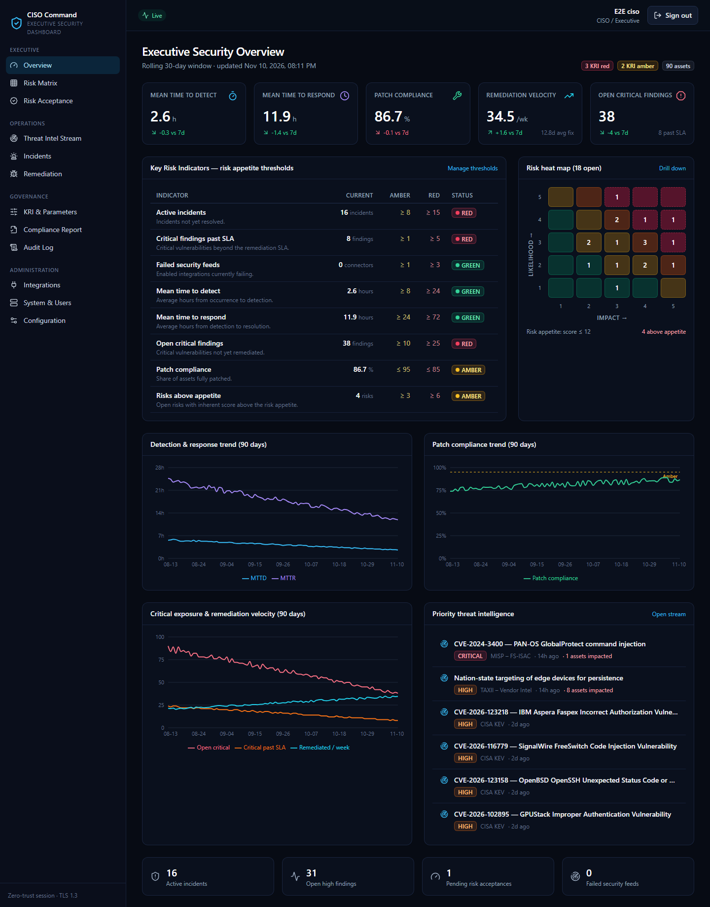

---

## 2. Signing in

### 2.1 First sign-in

You will receive a **username** and a **one-time password** from your administrator.

1. Open the dashboard address you were given (for example `https://ciso.corp.example/`) and select **Sign in**.
2. Enter your username and the one-time password.
3. **Set a new password.** It must meet the policy shown on screen. The default policy is at least 12 characters with an upper-case letter, a lower-case letter, a digit and a special character, and none of your last 12 passwords.
4. **Enrol an authenticator app.** Multi-factor authentication (MFA) is mandatory.
   - Install one of: Google Authenticator, Microsoft Authenticator, Authy or FreeOTP.
   - In the app, add an account and **scan the QR code** shown on screen. If you can't scan it, select *Unable to scan?* and type the key manually.
   - Type the **6-digit code** the app displays, and give the device a name (for example "Work phone").
5. You arrive at the Executive Overview.

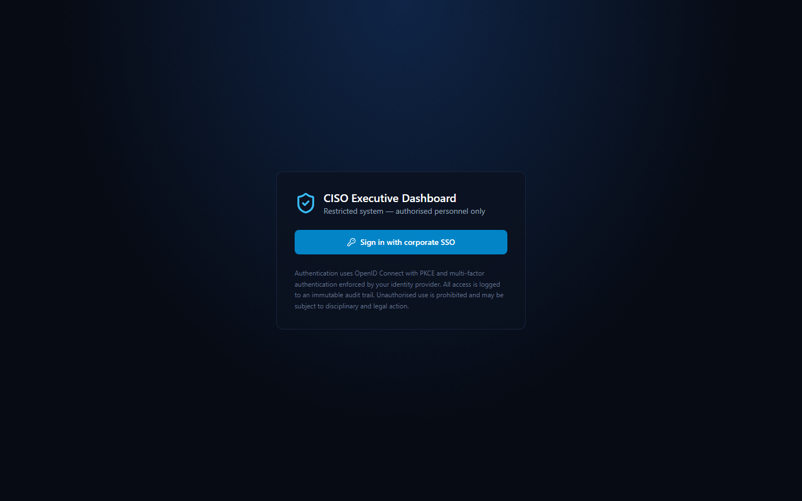

### 2.2 Everyday sign-in

Enter your username and password, then the current 6-digit code from your authenticator app.

### 2.3 Sessions and automatic sign-out

| Behaviour | Default | Notes |
|-----------|---------|-------|
| Background token refresh | every 10 minutes | Automatic and invisible |
| Idle timeout | 15 minutes | With no activity you must sign in again (PCI DSS 8.2.8) |
| Maximum session length | 8 hours | After this you must sign in again, even if you were active |

Administrators can change these values; the page shows the current ones. Select your name or the sign-out icon in the top bar to **sign out**. Signing out ends both the dashboard session and the identity-provider session.

### 2.4 Account lockout

After **5** wrong passwords or codes, the account is locked for **60 seconds**. Repeated failures lengthen the lock, up to **15 minutes**. Wait and try again, or ask an administrator.

### 2.5 Demo installations

On a demonstration system, the administrator account is **`admin` / `Admin@123!`**. You still have to enrol an authenticator at the first sign-in. This account must never exist on a production system.

---

## 3. Roles and what you can do

Your administrator assigns one or more roles. The menu shows only the pages your roles allow, and the server enforces every permission. Hiding a button is a convenience, not the control.

| Capability | CISO | Admin | SecOps | Patch Admin | Auditor |
|------------|:---:|:---:|:---:|:---:|:---:|
| Executive overview, KPIs, KRIs, risk matrix, threat stream, incidents, remediation (view) | ✅ | ✅ | ✅ | ✅ | ✅ |
| Edit KRI thresholds and risk parameters | ✅ | ✅ | | | |
| Acknowledge KRI breaches | ✅ | ✅ | ✅ | | |
| Register and edit risks | ✅ | | ✅ | | |
| Request a risk acceptance | ✅ | | ✅ | ✅ | |
| **Approve, reject or revoke a risk acceptance** (never your own request) | ✅ | | | | |
| Triage threat-intel items | ✅ | | ✅ | | |
| Log and update incidents | | | ✅ | | |
| Change remediation status, link change tickets | | | | ✅ | |
| View integrations | ✅ | ✅ | ✅ | | |
| Manage integrations (add, test, sync, credentials) | | ✅ | ✅ | | |
| View users | ✅ | ✅ | | | |
| Enrol users, change roles, reset passwords and MFA | | ✅ | | | |
| View Configuration | ✅ | ✅ | | | ✅ |
| Change Configuration, view system health and sessions | | ✅ | | | |
| Audit log (view, verify, export) and Compliance Report | ✅ | ✅ | | | ✅ |

**Separation of duties** is built in:
- Administrators run the platform but cannot approve risk acceptances or change remediation status.
- Nobody can approve their own acceptance request.
- Auditors are strictly read-only.

---

## 4. Finding your way around

The left-hand menu has three groups:

| Group | Pages |
|-------|-------|
| **Posture** | Overview · Risk Matrix · Risk Acceptance |
| **Operations** | Threat Intel Stream · Incidents · Remediation |
| **Governance** | KRI & Parameters · Compliance Report · Audit Log |
| **Platform** | Integrations · System & Users · Configuration |

- **Live updates.** Each page subscribes to server events. When a connector brings new data, or a colleague changes something, the affected tiles and tables refresh on their own. The threat stream shows a brief *Live update received* message.
- **Mobile.** The layout adapts to phones and tablets; the menu collapses behind the ☰ button.
- **Severity colours** are the same everywhere: Critical (red), High (orange), Medium (amber), Low (blue), Info (grey).

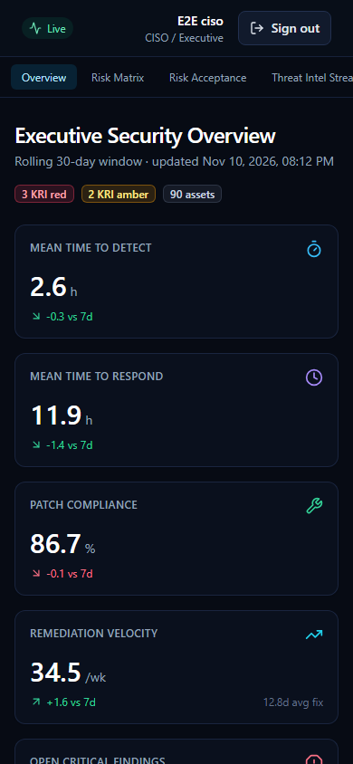

---

## 5. Executive Overview

The landing page answers "how are we doing, and where is the risk?".

### 5.1 KPI tiles

| Tile | Meaning | How it is calculated |
|------|---------|----------------------|
| **Mean time to detect (MTTD)** | How quickly incidents are noticed | Average of *detected − occurred* for incidents detected in the KPI window (default 30 days), in hours |
| **Mean time to respond (MTTR)** | How quickly incidents are resolved | Average of *resolved − detected* for incidents resolved in the window, in hours |
| **Patch compliance** | Share of assets fully patched | Compliant assets ÷ all assets, % |
| **Remediation velocity** | Findings fixed per week | Findings remediated in the window ÷ (window ÷ 7) |
| **Open critical findings** / **Open high findings** | Unfixed exposure | Findings with status Open or In progress |
| **Active incidents** | Incidents still being handled | Status New, Triage or Contained |
| **Failed security feeds** | Integrations currently failing | Enabled connectors with status Failed |
| **Pending risk acceptances** | Decisions waiting for the CISO | Requests with status Pending |

### 5.2 Key Risk Indicators table

Each KRI shows its current value, the Amber and Red thresholds, and a Red/Amber/Green status:
- "Higher is worse" KRIs (for example *Open critical findings*) turn Amber at or above the amber threshold, and Red at or above the red threshold.
- "Lower is worse" KRIs (for example *Patch compliance*) work the other way round.

The thresholds come from **KRI & Parameters**.

### 5.3 Trend charts (90 days)

- **Detection & response trend:** MTTD and MTTR.
- **Patch compliance trend.**
- **Critical exposure & remediation velocity:** open critical findings against fixes per week.

A KPI snapshot is taken every 15 minutes, and the charts plot one point per day.

### 5.4 Priority threat intelligence

The latest critical and high threat items. Select one to open it in the Threat Intel Stream.

---

## 6. Risk Matrix and the risk register

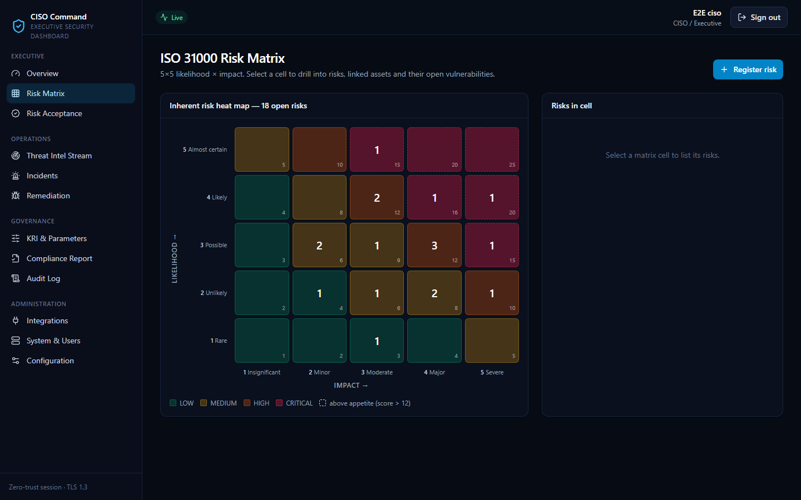

### 6.1 Reading the matrix

The 5×5 grid places each **open** risk by **likelihood** (1–5, vertical) and **impact** (1–5, horizontal). The number in a cell is the count of risks there.

| Score (likelihood × impact) | Level |
|-----------------------------|-------|
| 15–25 | Critical |
| 10–14 | High |
| 5–9 | Medium |
| 1–4 | Low |

Cells **above the risk appetite** are outlined. The default appetite is a score of 12; the CISO or an administrator can change it on KRI & Parameters.

### 6.2 Drilling down

Select a cell to list its risks, then select a risk to see:
- its description, owner, category, treatment and status
- **linked assets**, each with its **open vulnerabilities**, severity and SLA due date
- its **risk acceptance history**

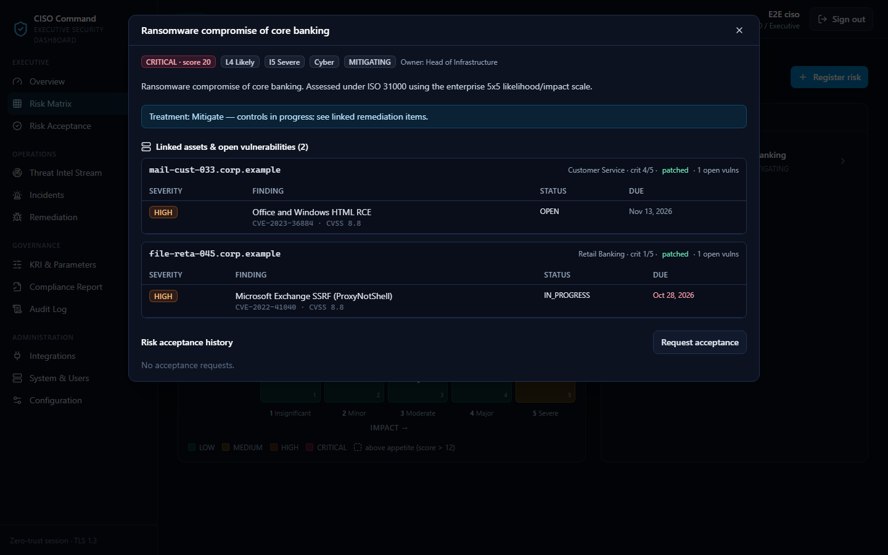

### 6.3 Registering a risk (CISO, SecOps)

Select **Register risk** and complete:

| Field | Rules |
|-------|-------|
| Title | 3–200 characters, single line |
| Description | 1–4000 characters |
| Category | for example *Ransomware*, *Third party*, *Cloud* |
| Likelihood, Impact | 1–5 each |
| Owner | the accountable person |
| Treatment | optional mitigation plan |
| Linked assets | optional; links the risk to assets so the drill-down shows their vulnerabilities |

To **edit** a risk, open it and change any field, including its status:
- *Open*
- *Mitigating*
- *Closed*

Closed risks leave the matrix. A risk that has been *Accepted* can change status only through the acceptance workflow.

---

## 7. Risk Acceptance

Risk acceptance is a formal decision to tolerate a risk for a limited time.

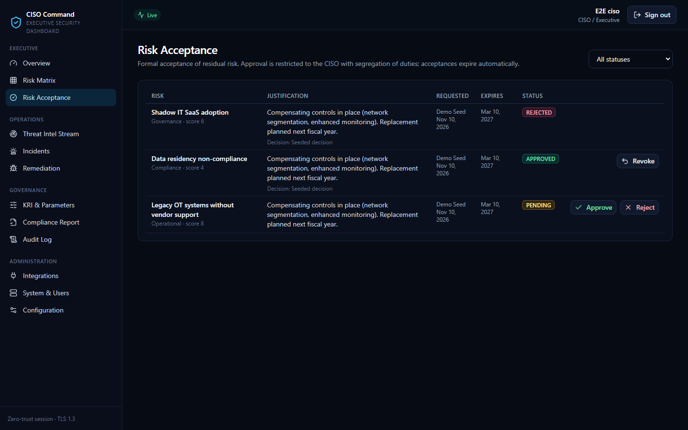

### 7.1 Requesting an acceptance (CISO, SecOps, Patch Admin)

1. Open the risk (Risk Matrix → cell → risk) and select **Request risk acceptance**.
2. Write a **justification** of at least 20 characters. Explain why the risk is tolerable and which compensating controls apply. The text is stored encrypted.
3. Choose the **validity** in days. It cannot exceed the maximum set by the CISO (default 180 days).

A risk can have only one pending or active acceptance at a time.

### 7.2 Deciding (CISO only)

1. Open **Risk Acceptance** and filter by *Pending*.
2. Read the justification, then select **Approve** or **Reject** and write a decision note of at least 5 characters.
3. When approved, the risk's status becomes *Accepted*.

You **cannot decide your own request**. The row is marked *Own request*, and the server refuses the decision and records the attempt in the audit log. Another CISO must decide.

### 7.3 Expiry and revocation

- On its expiry date an approved acceptance becomes **Expired** and the risk re-opens automatically. An hourly job does this.
- A CISO can **revoke** an approved acceptance early, with a note. The risk re-opens immediately.

| Status | Meaning |
|--------|---------|
| Pending | Waiting for a CISO decision |
| Approved | Risk formally accepted until the expiry date |
| Rejected | Not accepted; the risk stays open |
| Expired | Validity ended; the risk re-opened |
| Revoked | Withdrawn by a CISO before expiry |

---

## 8. Threat Intel Stream

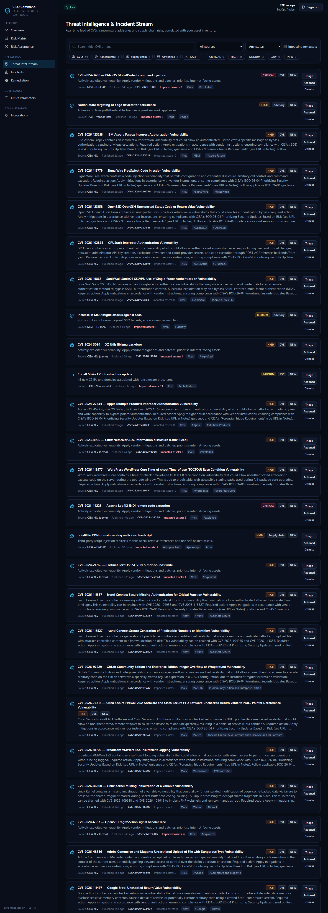

A real-time list of CVEs, ransomware advisories, supply-chain risks, general advisories and indicators of compromise (IOCs). Items are collected from every threat-intelligence connector.

### 8.1 Filters

- **Type:** CVE · Ransomware · Supply chain · Advisory · IOC
- **Severity:** Critical … Info
- **Status:** New · Triaged · Actioned · Dismissed
- **Source:** the connector that supplied the item (for example *CISA KEV*)
- **Search:** text in the title, a CVE ID, or a tag
- **Impacting my assets:** shows only items whose CVE matches an open finding on your assets. The *impacted assets* count on each item tells you how many.

The counters at the top show totals by severity and type for the current filter. Select **Load more** to page through older items.

### 8.2 Triage (CISO, SecOps)

Set an item's status and add an optional note:

| Status | Use when |
|--------|----------|
| New | Not yet reviewed (default) |
| Triaged | Reviewed; relevance understood |
| Actioned | Mitigation or patching under way |
| Dismissed | Not relevant to the organisation |

Every triage decision is audited.

---

## 9. Incidents

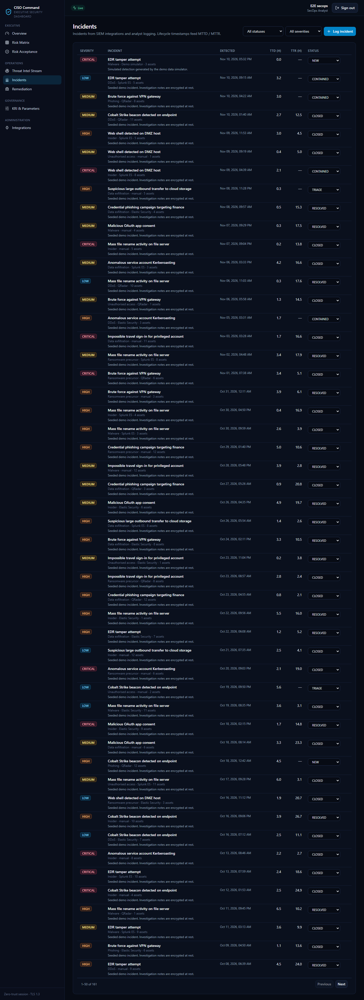

Incidents come from SIEM connectors, and SecOps analysts can also log them by hand. MTTD and MTTR are calculated from their timestamps.

### 9.1 The incident list

Filter by status, by severity, or by text in the title. The **TTD (h)** column is time to detect; **TTR (h)** is time to resolve.

### 9.2 Logging an incident (SecOps)

Select **Log incident** and fill in:

| Field | Rules |
|-------|-------|
| Title | 3–200 characters |
| Description | optional, up to 8000 characters (stored encrypted) |
| Severity | Critical, High, Medium, Low or Info |
| Category | for example *Phishing*, *Malware* (default *General*) |
| Occurred at | when the event started |
| Detected at | when it was noticed. It cannot be before *Occurred at* or in the future |
| Assets affected | number of assets |

### 9.3 Lifecycle

Change the status from the list:

```
NEW → TRIAGE → CONTAINED → RESOLVED → CLOSED
```

- The first move out of *New* records the **responded** time.
- Moving to *Resolved* or *Closed* records the **resolved** time, which feeds MTTR.
- Re-opening an incident (back to New, Triage or Contained) clears the resolved time.

---

## 10. Remediation

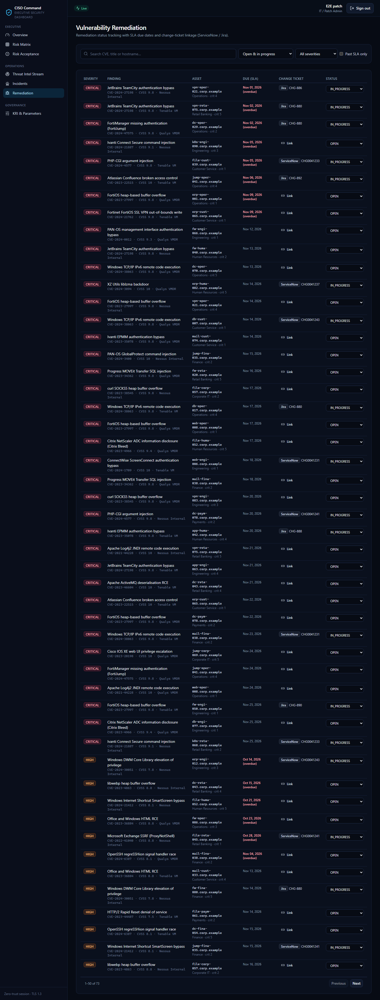

Vulnerability findings from scanners, grouped by asset, with SLA due dates.

### 10.1 The findings list

- **Filters:** status, severity, text search (CVE, title or hostname), and **Past SLA only** (Open or In progress findings past their due date).
- **Due (SLA)** is calculated when the finding is first seen: discovery date + the SLA for its severity. Defaults are Critical 15, High 30, Medium 90 and Low 180 days. Overdue dates are shown in red.

### 10.2 Updating status (Patch Admin)

| Status | Meaning |
|--------|---------|
| Open | Found, not yet worked |
| In progress | Remediation under way (set automatically when you link a change ticket) |
| Remediated | Fixed. The remediation date is recorded and counts towards remediation velocity |
| False positive | Not a real vulnerability |
| Risk accepted | Set only through the risk acceptance workflow; it cannot be changed here |

When a scanner later reports the finding as fixed, the connector updates it automatically.

### 10.3 Linking a change ticket (Patch Admin)

Select **Link ticket** on a finding and enter:
- the **system**, for example *ServiceNow*
- the **ticket key**, for example `CHG0041234`
- optionally a title and an **https** link

The finding moves to *In progress*. Tickets imported by change-management connectors appear with their live status and a link back to the ITSM tool.

---

## 11. KRI & Parameters

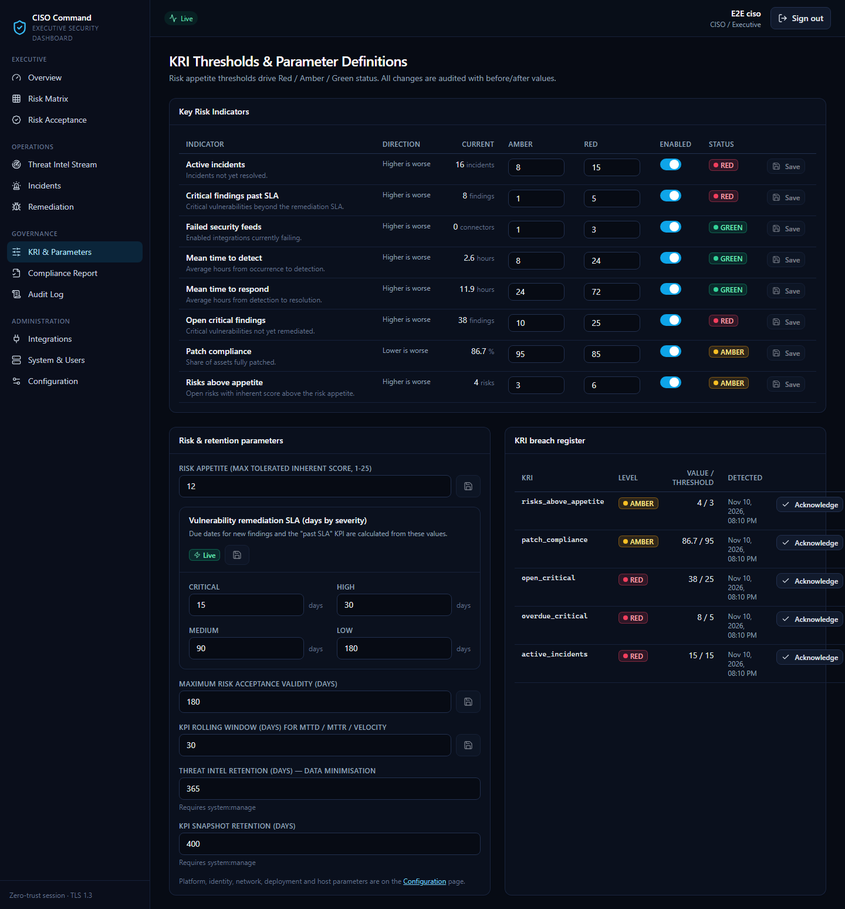

### 11.1 Key Risk Indicators (CISO, Admin)

Each KRI has an **Amber** and a **Red** threshold and can be enabled or disabled:
- For a "higher is worse" KRI, Red must be greater than Amber.
- For a "lower is worse" KRI, Red must be lower than Amber.

The server rejects thresholds the wrong way round.

| KRI | Direction | Amber | Red |
|-----|-----------|------:|----:|
| Open critical findings | higher is worse | 10 | 25 |
| Critical findings past SLA | higher is worse | 1 | 5 |
| Patch compliance (%) | lower is worse | 95 | 85 |
| Mean time to detect (h) | higher is worse | 8 | 24 |
| Mean time to respond (h) | higher is worse | 24 | 72 |
| Risks above appetite | higher is worse | 3 | 6 |
| Failed security feeds | higher is worse | 1 | 3 |
| Active incidents | higher is worse | 8 | 15 |

*(Defaults shown; your organisation may have changed them.)*

KRIs are evaluated every 5 minutes. A change to Amber or Red is written to the **KRI breach register**.

### 11.2 KRI breach register (CISO, Admin, SecOps)

Lists breaches with the time, level and measured value. Select **Acknowledge** to record that you have seen a breach; the acknowledgement is audited.

### 11.3 Risk & retention parameters

| Parameter | Default | Who can change it |
|-----------|---------|-------------------|
| Risk appetite (maximum tolerated score, 1–25) | 12 | CISO, Admin |
| Vulnerability SLA days (Critical / High / Medium / Low) | 15 / 30 / 90 / 180 | CISO, Admin |
| Maximum risk acceptance validity | 180 days | CISO, Admin |
| KPI rolling window | 30 days | CISO, Admin |
| Threat-intel retention | 365 days | Admin |
| KPI snapshot retention | 400 days | Admin |

Changes take effect within seconds and are audited with before and after values. Some values show a compliance warning, for example a Critical SLA above 30 days (PCI DSS 6.3.3). A link leads to the full **Configuration** page.

---

## 12. Compliance Report

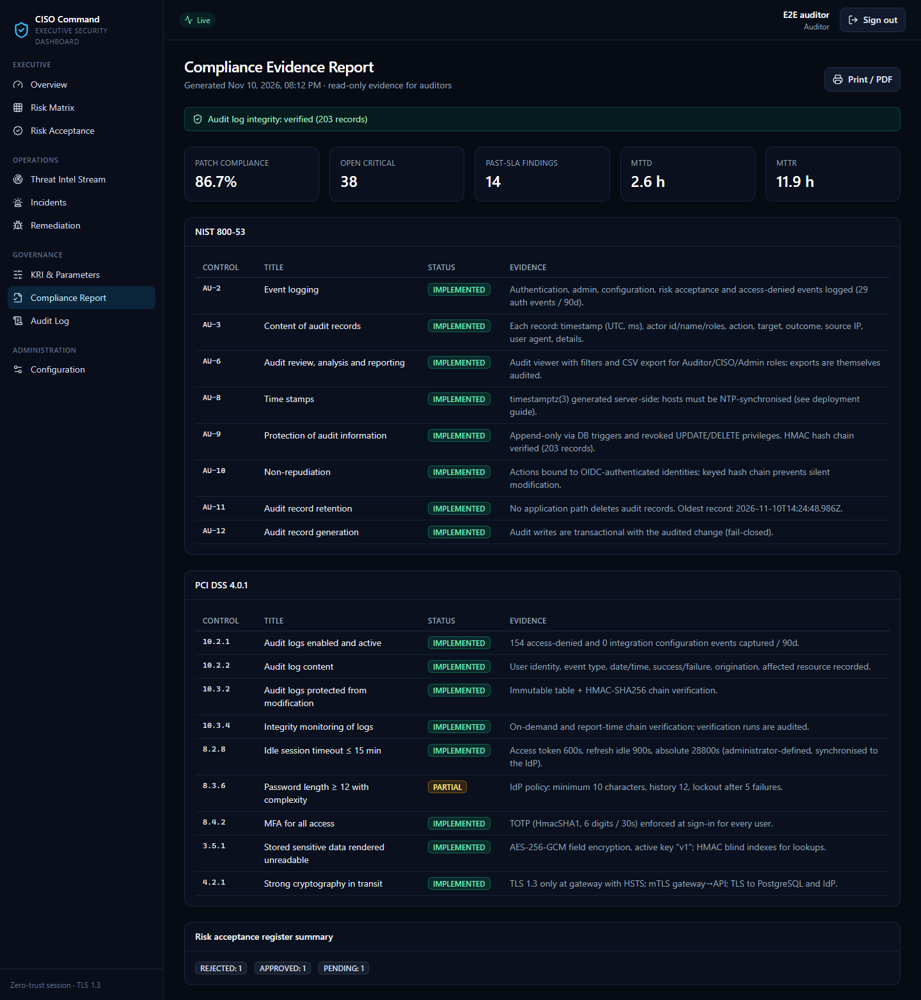

Available to the CISO, Admin and Auditor. The report is generated live each time you open it. It maps implemented controls to:
- **NIST SP 800-53 Rev. 5**, AU family (AU-2, 3, 6, 8, 9, 10, 11, 12)
- **PCI DSS v4.0.1**, requirements 10.2.1, 10.2.2, 10.3.2, 10.3.4, 8.2.8, 8.3.6, 8.4.2, 3.5.1 and 4.2.1

Each control shows a status and evidence:
- *Implemented*
- *Partial*: for example, an idle timeout set above 15 minutes
- *Failed*: for example, a broken audit chain or MFA turned off

The report also summarises the posture KPIs and the risk-acceptance register by status. Use your browser's **Print → Save as PDF** to keep a copy as evidence. Generating the report is itself audited.

---

## 13. Audit Log

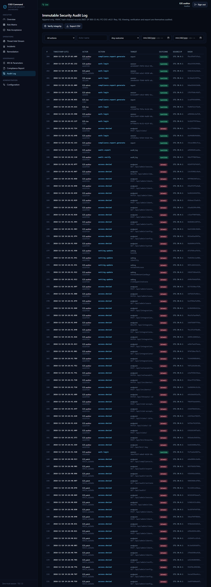

Every security-relevant action is recorded:
- sign-ins and sign-outs
- denied access
- changes to settings, integrations, risks, acceptances, incidents and findings
- exports and verifications

Records cannot be changed or deleted. Each record carries a keyed hash that chains it to the previous one, so tampering is detectable.

| Action | How |
|--------|-----|
| **Filter** | Action (prefix, for example `risk.`), actor name, outcome (Success / Failure / Denied), and a date range |
| **Load older records** | Pages back through history |
| **Verify integrity** | Recomputes the whole hash chain and reports *valid* or the first broken record. A broken chain is a security incident: inform the CISO immediately |
| **Export CSV** | Exports up to 50,000 records with the current filters. Cells are protected against spreadsheet formula injection |

Viewing, verifying and exporting the log are themselves audited.

---

## 14. Integrations (read view)

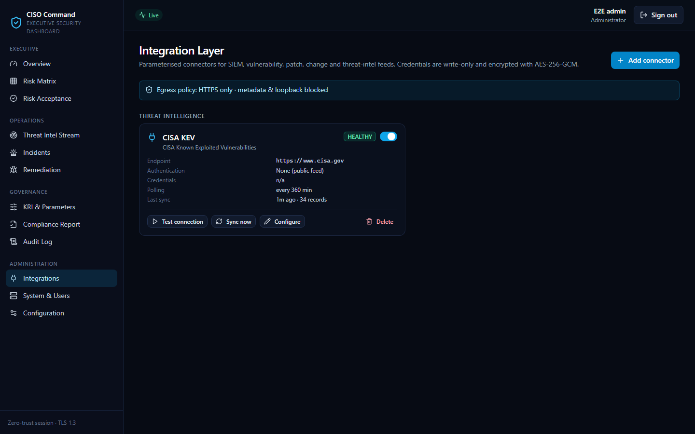

The CISO, Admin and SecOps can see every connector. Each shows:
- its **status**:
  - *Healthy*
  - *Untested*
  - *Failed*, with a safe error message
  - *Disabled*
- its last sync time and record count
- its polling interval and endpoint

Credentials are **never displayed**. The page shows only which credential fields are set.

Admin and SecOps can add, test, sync, re-configure and delete connectors, and replace credentials. See the [API & Integration Guide](API_AND_INTEGRATION_GUIDE.md#part-b-integration-requirements-and-guidelines) for vendor-specific set-up.

---

## 15. System & Users and Configuration (administrators)

**System & Users** (the CISO can view it; the Admin can change it) has three parts:
- **Identity & enrolment:** enrol a user (the one-time password is shown **once**; give it to the user securely), change roles, reset a password or authenticator, and disable, enable or delete a user. (*Enforce MFA for existing users* is on Configuration → Identity & enrolment.)
- **Dashboard accounts:** created automatically at a user's first sign-in. You can deactivate an account or revoke its sessions.
- **System health:** version, uptime, database latency, scheduler times, connector status counts, active sessions, number of audit records and security settings.

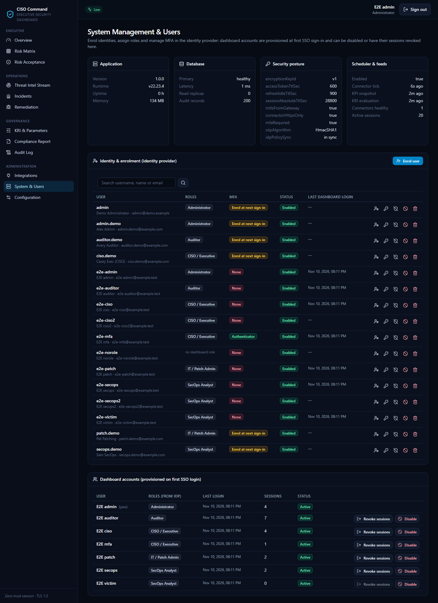

**Configuration** (CISO and Auditor can view it; the Admin can change it) holds every platform parameter:
- network access, rate limits, sessions, identity and MFA
- integration defaults, logging, demo data, deployment and host OS

The [Maintenance Manual](MAINTENANCE_MANUAL.md) explains each one.

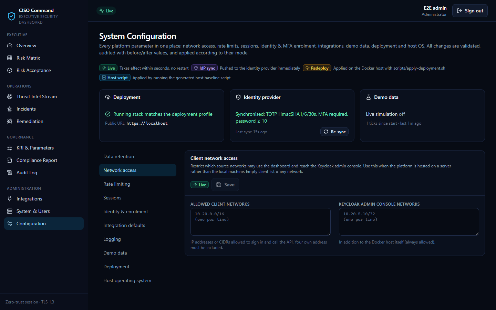

---

## 16. Task guides by role

### CISO: weekly posture review
1. **Overview:** check the KRI table for Red or Amber, and the MTTD/MTTR and patch-compliance trends.
2. **KRI & Parameters → breach register:** acknowledge breaches you have reviewed.
3. **Risk Acceptance:** filter *Pending* and decide each request (never your own).
4. **Risk Matrix:** review the cells above appetite and drill into the assets with overdue critical findings.
5. **Compliance Report:** confirm that every control is *Implemented*, then print to PDF for the board pack.

### SecOps analyst: daily operations
1. **Threat Intel Stream:** filter *Status = New* with **Impacting my assets** on; triage each item.
2. **Incidents:** move active incidents through the lifecycle; log any incident detected outside the SIEM.
3. **Integrations:** confirm that no feed is *Failed*, and run **Test** or **Sync now** if one is.
4. Register new risks you identify, and request acceptance where mitigation is not feasible.

### Patch administrator: remediation cycle
1. **Remediation:** tick **Past SLA only**, then filter Critical and High.
2. Link the change ticket for each planned fix; the finding becomes *In progress*.
3. After deployment, set it to *Remediated*, or wait for the next scanner sync to confirm the fix.
4. If a fix is impossible before the SLA, request a risk acceptance on the related risk.

### Auditor: evidence collection
1. **Audit Log → Verify integrity:** record the result and the time.
2. **Audit Log → Export CSV** for the review period.
3. **Compliance Report:** print to PDF.
4. **Configuration** (read-only): record the session, MFA and password policies in force.

### Administrator: onboarding a new user
1. **System & Users → Identity & enrolment → Enrol user**: enter the username, email, name and roles.
2. Copy the **one-time password** (shown once) and give it to the user over a separate channel.
3. At first sign-in, the user sets a password and enrols an authenticator.
4. To remove access later, **Disable** the identity first (this ends their sessions immediately), then **Delete** it when appropriate.

---

## 17. Messages and what to do

| Message or symptom | Meaning | What to do |
|--------------------|---------|------------|
| *Invalid authenticator code* | The code is wrong or expired, or your phone's clock is off | Wait for a fresh code; make sure the phone sets its time automatically |
| *Invalid username or password* even though your details are correct, after several failed attempts | Temporary lockout. To avoid revealing which accounts exist, the sign-in page doesn't say the account is locked | Wait up to 15 minutes, or ask an administrator |
| Lost or replaced phone | You can't produce codes | Ask an administrator to **Reset MFA**; you enrol again at the next sign-in |
| Forgotten password | — | Ask an administrator to **Reset password**; you receive a new one-time password |
| Sign-in returns with `error=no_authorized_role` | Your identity has no dashboard role | Ask an administrator to assign a role |
| Sign-in returns with `error=account_disabled` | Your dashboard account was deactivated | Contact an administrator |
| Sign-in returns with `error=invalid_state` or `missing_state` | The sign-in took longer than 10 minutes, or cookies are blocked | Start again from the dashboard address; allow cookies for the site |
| *Session expired*, back to sign-in | Idle timeout or maximum session length reached | Sign in again |
| *Too many requests — slow down…* (HTTP 429) | You exceeded your personal request quota (default 600 per minute, or 30 per minute for syncs, exports and verifications) | Wait for the indicated time; colleagues are not affected |
| *Insufficient privileges* (403) | Your role does not allow the action | Ask an administrator if you need the role; the attempt is audited |
| *Access from your network is not permitted* (403) | You are connecting from a network outside the allow list | Use the corporate network or VPN |
| *Segregation of duties: you cannot approve your own request* | You tried to decide your own acceptance | Another CISO must decide it |
| Browser certificate warning | The site certificate is not trusted on this device | Ask IT to install the organisation's CA certificate; do not click through on production |

---

## 18. Glossary

| Term | Meaning |
|------|---------|
| **Asset** | A host (server, workstation, appliance) identified by hostname, created automatically from scanner and patch data |
| **Connector** | A configured integration with one security tool |
| **Finding / vulnerability** | A weakness reported on an asset by a scanner |
| **KPI** | Key performance indicator: a measure of security operations |
| **KRI** | Key risk indicator: a measure compared against risk-appetite thresholds |
| **MTTD / MTTR** | Mean time to detect / mean time to respond, in hours |
| **Risk appetite** | The highest risk score the organisation tolerates without formal acceptance |
| **RAG** | Red / Amber / Green status |
| **SLA** | Maximum days allowed to remediate a finding of a given severity |
| **SoD** | Segregation of duties: the requester cannot be the approver |
| **TOTP** | Time-based one-time password: the 6-digit code from an authenticator app |
